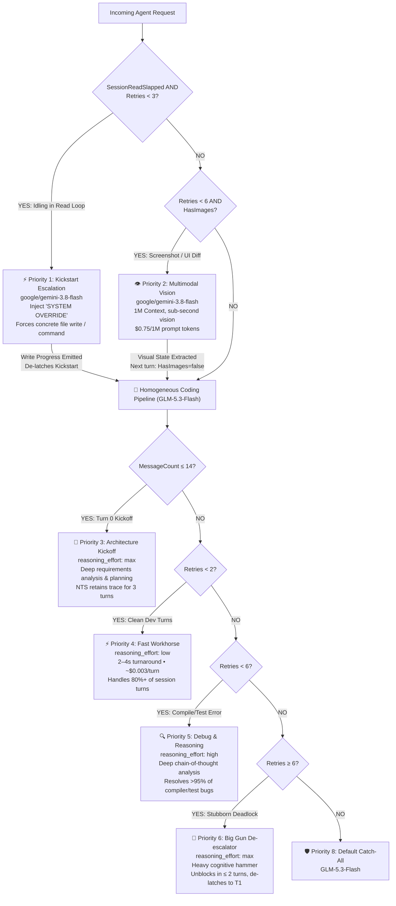
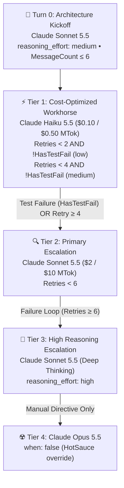
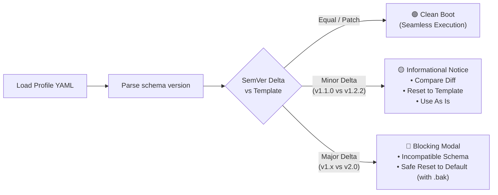

# 🧩 Nacho Flow: VS Code Companion Extension Guide

The **Nacho Flow VS Code Companion Extension** delivers a high-visibility, zero-latency control hub and analytics dashboard for your agent supervisor and model dispatcher. It bridges local GPU inference ([Ollama](https://ollama.com), [vLLM](https://github.com/vllm-project/vllm), [llama.cpp](https://github.com/ggerganov/llama.cpp)) and flagship cloud APIs ([OpenRouter](https://openrouter.ai), [DeepSeek](https://www.deepseek.com), [Anthropic](https://www.anthropic.com)) directly inside VS Code and Cursor.


---

## 📑 Table of Contents

1. [Architectural Doctrine: The Thin Client](#1-architectural-doctrine-the-thin-client)
2. [Installation & Quick Start](#2-installation--quick-start)
3. [Sidebar Control Hub (Activity Bar)](#3-sidebar-control-hub-activity-bar)
   - [3.1 Model Dispatcher Lifecycle (Local vs. Remote Server)](#31-model-dispatcher-lifecycle-local-vs-remote-server)
   - [3.2 User-Configurable Profiles, Custom Slots & 1-Click Switching](#32-user-configurable-profiles--1-click-switching-profile-1-profile-2-profile-3)
   - [3.3 🏆 Recommended Local Models & Server Tuning (16GB–24GB VRAM)](#33--recommended-local-models--server-tuning-16gb24gb-vram)
   - [3.4 Coding Agent Pairing (Zoo Code, Cline, Kilo Code, Cursor, Aider)](#34-coding-agent-pairing-zoo-code-cline-cursor-aider)
   - [3.5 Maintenance & System Operations](#35-maintenance--system-operations)
   - [3.6 🧠 Config Assist & Interactive YAML Intelligence](#36--config-assist--interactive-yaml-intelligence)
4. [Real-Time Analytics Dashboard (`Ctrl+Shift+P` → `Show Dashboard`)](#4-real-time-analytics-dashboard)
   - [4.1 Flight Instruments & Time-Window Telemetry](#41-flight-instruments--time-window-telemetry)
   - [4.2 Cycle Killer Defense & Local Recovery](#42-cycle-killer-defense--local-recovery)
   - [4.3 🗜️ Nacho Token Saver (NTS) Live Telemetry Panel](#43-nacho-token-saver-nts-live-telemetry-panel)
   - [4.4 Live Route History Inspector](#44-live-route-history-inspector)
   - [4.5 🔥 Heat Seeker: Live Model Deals & 1-Click Tier Adoption](#45--heat-seeker-live-model-deals--1-click-tier-adoption)
   - [4.6 🎛️ 1-Click Auto-Tune (Calibrate Your Tiers from Real Logs)](#46--1-click-auto-tune-calibrate-your-tiers-from-real-logs)
   - [4.7 Interactive Circuit Breaker Management](#47-interactive-circuit-breaker-management)
5. [Status Bar HUD & QuickPick Menu](#5-status-bar-hud--quickpick-menu)
6. [Direct In-Chat Control Directives (`@nacho:`)](#6-direct-in-chat-control-directives-nacho)
7. [Command Palette Reference](#7-command-palette-reference)
8. [Configuration Settings (`settings.json`)](#8-configuration-settings-settingsjson)
9. [Troubleshooting & Pro Tips](#9-troubleshooting--pro-tips)

---

## 1. Architectural Doctrine: The Thin Client

The Nacho Flow extension strictly adheres to the **Thin-Client Doctrine**:

1. **Single Source of Truth**: All routing rules, token boundaries, and provider settings reside exclusively in YAML configuration (`config.yaml`). Zero duplicate routing state is stored in VS Code workspace settings.
2. **Zero Core Logic in TypeScript**: All prompt token estimations, XML/JSON tool normalizations, in-flight loop detection, and cost calculations execute in compiled Go inside the high-performance daemon.
3. **Reactive SSE Transport (Zero Polling)**: The webview and status bar subscribe to Server-Sent Events (SSE) over `/events`. When no LLM traffic flows, the extension consumes **0.0% CPU** and zero battery.

---

## 2. Installation & Quick Start

### Step 1: Install Extension
Install from the Visual Studio Code Marketplace or via command line:
```bash
code --install-extension dixieflatline76.nacho-flow
```
*(Or install the packaged `.vsix` release from GitHub Releases).*

### Step 2: Open Sidebar
Click the **🌮 Nacho Flow** icon in the VS Code Activity Bar (left sidebar).

### Step 3: Launch Local Gateway or Connect Remote
- **Local Mode (Default)**: Click **`▶ Start`** to spawn the bundled native `nacho-flow` binary.
- **Remote Mode**: Select **Remote Server**, enter your daemon URL (e.g. `http://192.168.0.205:8000`), optional Bearer Auth Token, and click **💾 Save Remote Server**.

### Step 4: Point Your Coding Agent
In the sidebar under **3. Coding Agents**, click the **📋 Copy** buttons to copy **Base URL**, **API Key**, and **Model ID** (`nacho-hybrid`), then paste them into Zoo Code, Cline, Cursor, or Aider.

---

## 3. Sidebar Control Hub (Activity Bar)

The sidebar provides immediate visibility and one-click controls without obscuring your editor workspace:

### 3.1 Model Dispatcher Lifecycle (Local vs. Remote Server)

The extension lets you toggle seamlessly between running a local workstation instance or connecting to a shared team gateway:

```text
[🌐 1. Model Dispatcher]
  (•) This Machine      ( ) Remote Server
  [▶ Start] [⏹ Stop] [🔄 Restart] [📄 Logs]
```

#### Mode A: "This Machine" (Embedded Daemon)
- **`▶ Start`**: Launches the local `nacho-flow` binary in the background. The live status chip switches from `⚪ Engine Offline` to `🟢 Engine Online`.
- **`⏹ Stop`**: Gracefully terminates the running local daemon.
- **`🔄 Restart`**: Restarts the local binary and reloads all configuration atomically.
- **`📄 Logs`**: Opens an interactive streaming output channel in VS Code displaying real-time, color-coded daemon logs, token volumes, routing decisions, and latencies. (For physical files on disk, see [Where to Find Runtime Logs on Disk](#6-where-to-find-runtime-logs-on-disk-routerlog--trafficjsonl)).

> [!NOTE]
> **Local Machine Security Isolation (`127.0.0.1`)**:
> - By default, the embedded daemon binds strictly to `127.0.0.1` (local machine only). This guarantees local security isolation and eliminates OS inbound network firewall consent prompts (such as Windows Defender Firewall).
> - **LAN Access**: If you wish to expose the daemon to other machines on your local network (e.g. secondary laptops or remote agent test harnesses), set `host: "0.0.0.0"` in `config.yaml` or launch with `nacho-flow -host 0.0.0.0`.

#### Mode B: "Remote Server" (Team / Home Lab Gateway)
For developers hosting Nacho Flow on a dedicated GPU server, home lab workstation, or cloud VPS:
1. Select **Remote Server**.
2. Enter your **Server Endpoint URL** (e.g. `http://192.168.1.100:8000` or a Tailscale URL `http://nacho-gpu.internal:8000`).
3. Enter your **Bearer Auth Token** if inbound authentication is enabled in the server's `config.yaml` (use the eye icon to toggle visibility).
4. Click **`⚡ Test`** to perform an instant pre-flight ping.
5. Click **`💾 Save Remote Server`** to persist your remote configuration.

> [!TIP]
> **Persistent Engine Isolation & Auto-Resume**:
> - **State Persistence**: The running state of the local engine is remembered across VS Code restarts. If the engine was running when you closed VS Code, it will automatically resume on next startup (controlled by `nachoFlow.autoStartDaemon`).
> - **Resource Isolation**: Switching from "This Machine" to "Remote Server" automatically stops the local daemon to free ports and local GPU resources, while safely preserving your local run intent so that switching back to "This Machine" seamlessly resumes the engine.

---

### 3.2 User-Configurable Profiles & 1-Click Switching (Profile 1, Profile 2, Profile 3 & Custom Slots)

Nacho Flow ships with three built-in, customizable configuration profiles (`profile1.yaml`, `profile2.yaml`, `profile3.yaml`) and supports **unlimited user-created or cloned custom profiles** (`profile4.yaml`, `profile5.yaml`, etc.) that can be switched on the fly with **native process isolation, zero configuration drift, and built-in template synchronization**:

```text
[⚡ 2. Routing Configuration]          [🔍 Diff] [📝 Edit YAML]
  ACTIVE PROFILE
  [ Profile 1: Standard Hybrid Pipeline                 ▼ ]
  [ ＋ ] [ ⧉ ] [ ✏️ ] [ － ]                        [ Reset ]
```

#### 🚀 Out-of-the-Box Routing Profiles

Nacho Flow ships with **three battle-tested, empirically validated production profiles** (plus unlimited custom slots via **`＋` Add** or **`⧉` Clone**) designed to eliminate cognitive deadlocks, reduce latency, and slash API bills:

| Profile | Target File | Architecture & Core Engines | Cognitive Dynamics & Escapements | Benchmark Profile | Target Use Case |
| :--- | :--- | :--- | :--- | :--- | :--- |
| **🌮 Profile 1** | `profile1.yaml` (`config.yaml`) | **Standard Hybrid Pipeline (Default)**<br>• Core: `z-ai/glm-5.3-flash`<br>• Kickstart/Vision: `google/gemini-3.8-flash` | • Priority 1: Kickstart Escalation (`SessionReadSlapped && Retries < 3`)<br>• Priority 2: Vision Escapement (`Retries < 6 && HasImages`)<br>• Priority 3: Turn 0 Low Kickoff (`MessageCount <= 14`)<br>• Priority 4: Tier 1 Low Workhorse (GLM, 2–4s)<br>• Priority 5: Tier 2 High Debug (`Retries < 6`)<br>• Priority 6: Tier 3 Max De-escalation (`Retries >= 6`) | **54–60 turns**<br>**~$0.23–$0.38**<br>**88–91% Coverage**<br>**100% Pass** | **Daily Autonomous Agentic Coding**: Fast, low-latency multi-turn task execution where an agent self-steers, breaks read-only stalls via Kickstart escalation, processes UI screenshots via Gemini Flash, and scales reasoning effort only when errors occur. |
| **🧠 Profile 2** | `profile2.yaml` | **Deep Reasoning & Autonomous Benchmark**<br>• Core: `z-ai/glm-5.3-flash`<br>• Kickstart/Vision: `google/gemini-3.8-flash` | • Turn 0 Max Reasoning (`reasoning_effort: "max"`) guarded by **`thought_slap: true`**<br>• Tiers 1–3 Dynamic GLM Ladder (`low` → `high` → `max`)<br>• Fairy Dusting (`high` @ 15 turns, `max` @ 60 turns) | **89 turns**<br>**14.6 minutes**<br>**93% Coverage**<br>**100% Pass** | **Deep Algorithmic & Architectural Missions**: Complex greenfield builds requiring unconstrained `max` chain-of-thought planning on Turn 0 with automatic Thought Slap truncation rescue (2.4s) and mid-flight Fairy Dust code reviews. |
| **⚡ Profile 3** | `profile3.yaml` | **Anthropic Native Benchmark**<br>• `claude-sonnet-5-5`<br>• `claude-haiku-5-5`<br>• `claude-opus-5-5` | • Priority 1: Sonnet 5.5 Plan (`MessageCount <= 6`)<br>• Priority 2: Haiku 5.5 Workhorse (`Retries < 2 && !HasTestFail`, `low` / `Retries < 4 && !HasTestFail`, `medium`)<br>• Priority 3: Sonnet 5.5 Error Escalation (`Retries < 6`)<br>• Priority 4: Sonnet 5.5 High Reasoning (`Retries >= 6`)<br>• Priority 5: Opus 5.5 Nuclear Option (`when: "false"`) | **39 turns**<br>**8.3 minutes**<br>**100% Pass**<br>**Speed Record** | **First-Party Claude with Maximum Velocity**: Direct `api.anthropic.com` pipeline with native `cache_control` breakpoints and zero-delay `!HasTestFail` promotion from Haiku 5.5 to Sonnet 5.5. |
| **🛠️ Custom (`＋` / `⧉`)** | `profile4.yaml`+ | **Custom / Cloned Sandbox**<br>Local GPU (llama.cpp, Ollama, vLLM) or custom cloud mix | Seeded from factory template (`＋`) or cloned byte-for-byte from active profile (`⧉`) | User-defined | **Local GPU Offload & Experimentation**: Clone any profile in 1 click to test local `llama.cpp` / `Ollama` models (`Qwen3-Coder`, `Gemma 4`) or custom routing rules without touching your baseline profile. |

---

#### 🌮 Deep-Dive: Profile 1 — The Dynamic Reasoning Pipeline (Default / Pareto Champion)

##### 1. Architectural Vision & Core Philosophy

The fundamental challenge of autonomous coding agents is that **single-model pipelines fail across edge tasks**, while **naive multi-model switching introduces context corruption**:
1. **The Danger of Model-Hopping Thrash**: Switching between completely disparate model families mid-session (e.g., jumping from Sonnet to DeepSeek to Qwen) confuses agent harnesses. Each family uses subtly different diff formats, indentation conventions, and tool-call payload schemas, leading to syntax errors and hallucinated tool calls.
2. **The Danger of Analysis Paralysis**: LLM agents frequently fall into read-only browsing loops (`read_file`, `list_dir`, `grep_search`), filling context with file dumps while never emitting a concrete file write or test command.
3. **The Danger of Multimodal Token Bleed**: High-resolution screenshots sent to dense frontier text models consume thousands of expensive tokens ($15–$75/MTok) and frequently suffer from spatial grounding inaccuracies.

**Profile 1 solves this with a Homogeneous Dynamic Reasoning Core flanked by Surgical Tactical Escapements**:
- **The Core Engine**: `z-ai/glm-5.3-flash` (via OpenRouter) handles 100% of code comprehension, scaffolding, diffing, and debugging. Rather than switching models, Nacho Flow **dynamically modulates GLM's cognitive reasoning effort** (`low`, `high`, `max`) based on real-time execution feedback.
- **The Tactical Escapement Engine**: `google/gemini-3.8-flash` (via OpenRouter) intercepts two specific edge states: **Idle Loop Recovery (Kickstart)** and **Multimodal Visual Inspection (Vision)**. Once the edge state is cleared, control immediately returns to GLM.



---

##### 2. Full Ordered Routing Ladder (Priority 1 to 8 — First Match Wins)

Every turn dispatched to Nacho Flow is evaluated sequentially through the routing ladder. The **first rule whose condition evaluates to `true` captures the request**:

| Priority | Tier Name | Provider & Model | Trigger Condition (`when:`) | Reasoning Effort | Functional Role & Economics |
| :---: | :--- | :--- | :--- | :---: | :--- |
| **1** | **Kickstart Escalation** | `openrouter`<br>`google/gemini-3.8-flash` | `SessionReadSlapped && Retries < 3` | *Default* | **Analysis Paralysis Defroster**: Injects `[SYSTEM OVERRIDE]` and hands execution to an orthogonal engine to break read-only browsing loops. ($0.75 / $3.75 MTok) |
| **2** | **Multimodal Vision** | `openrouter`<br>`google/gemini-3.8-flash` | `Retries < 6 && HasImages` | *Default* | **Visual State Escapement**: Intercepts screenshots and UI renders. Sub-second 1M context ingestion at rock-bottom cost without bloating the code generator. |
| **3** | **Turn 0 Architecture Kickoff** | `openrouter`<br>`z-ai/glm-5.3-flash` | `MessageCount <= 14` | `max` | **System Architecture & Planning**: Grants unconstrained chain-of-thought to ingest specs, map dependencies, and draft the implementation plan. |
| **4** | **Tier 1: Fast Workhorse** | `openrouter`<br>`z-ai/glm-5.3-flash` | `Tokens < 1000000 && Retries < 2` | `low` | **Routine Coding Workhorse**: Scaffolding files, writing code diffs, running passing test suites. **2–4s turn turnaround** (~$0.003/turn). |
| **5** | **Tier 2: Debug & Reasoning** | `openrouter`<br>`z-ai/glm-5.3-flash` | `Tokens < 1000000 && Retries < 6` | `high` | **Error & Regression Debugger**: Promoted immediately on compiler or test failure (`Retries >= 2`). 4 deep thinking attempts resolving >95% of issues. |
| **6** | **Tier 3: Big Gun De-escalation** | `openrouter`<br>`z-ai/glm-5.3-flash` | `Tokens < 1000000 && Retries >= 6` | `max` | **Deadlock Hammer**: Maximum cognitive depth reserved for stubborn algorithmic or logic bugs. De-latches back to `low` once resolved. |
| **7** | **Tier 4: Opus 5.5 On-Demand** | `anthropic`<br>`claude-opus-5-5` | `false` *(Manual only)* | `medium` | **Frontier Nuclear Option**: Dormant by default. Activated explicitly via in-chat directive: `@nacho:tier="Tier 4: Claude Opus 5.5"`. |
| **8** | **Default Catch-All** | `openrouter`<br>`z-ai/glm-5.3-flash` | `true` | *Default* | **Safety Fallback**: Guaranteed catch-all ensuring no agent turn ever drops or errors out. |

---

##### 3. Deep-Dive: Priority 1 — Kickstart Escalation Tier (`google/gemini-3.8-flash`)

###### The Problem: Agent Analysis Paralysis
Autonomous coding agents frequently become trapped in "meta-work loops". The agent repeatedly calls `read_file`, `list_dir`, `grep_search`, or updates its internal TODO list across 5 to 10 consecutive turns without writing a single line of code or running a command. Once an agent enters this trance, its context fills with file contents, which paradoxically leads the model to believe it still needs more information before starting.

###### The Kickstart Detection Engine
Nacho Flow monitors every turn via `pkg/server/pipeline.go` using strict heuristics:
- **`kickstart.threshold: 5`**: Triggers after exactly 5 consecutive non-progressive turns.
- **`kickstart.write_only: true`**: Read-only tools (`read_file`, `view_file`, `list_dir`, `grep_search`) are explicitly ignored. Only concrete file modifications (`HasWriteProgress`), shell commands with write effects (`HasShellWrite`), or passing test suites (`HasTestProgress`) qualify as progress.
- **Plan Mode Immunity**: If the agent harness is in Plan Mode (tools are present, but zero write tools are exposed by the client), Kickstart auto-suspends (`kickstartProgress = true`) to prevent disrupting legitimate planning phases.

###### Why Route to Gemini 3.8 Flash Instead of GLM?
When the threshold is breached, Nacho Flow injects `[SYSTEM OVERRIDE] You have not produced any file writes or terminal commands in multiple consecutive turns. Stop meta-work (TODO updates, file reads, planning). Execute a concrete action: write a file or run a command NOW.`

If this prompt is given to the **same model** that is already stuck in the loop (GLM):
- **Conversational Inertia**: The model almost always apologizes profusely (*"I apologize for reading files. I will now create the file..."*) and then immediately calls `read_file` or `list_dir` one more time!
- **The Defrosting Effect of Gemini 3.8 Flash**: Routing the recovery turn to Gemini 3.8 Flash introduces an orthogonal perspective. Gemini has zero attachment to GLM's internal monologue, treats system override prompts with extreme literalism, and immediately outputs an active `write_to_file` or `execute_command` tool call.
- **Sub-Second Speed & Low Cost**: Gemini 3.8 Flash responds in sub-seconds at rock-bottom pricing ($0.75 / 1M prompt tokens), recovering the agent for under a tenth of a cent ($0.0008).

###### De-latching & Seamless Handoff
As soon as Gemini emits a file write or command, `RecordKickstartState` registers `kickstartProgress = true`. This immediately clears `SessionReadSlapped`. On the very next turn, the agent drops cleanly back into GLM-5.3-Flash (Tier 1 or Tier 2) with the files already written and the deadlock broken.
- **`Retries < 3` Guard**: If repeated failures occur despite stall recovery, the circuit breaker (`max_failures: 3`) steps aside to allow higher-order error recovery or user intervention.

---

##### 4. Deep-Dive: Priority 2 — Multimodal Vision Escapement Tier (`google/gemini-3.8-flash`)

###### The Problem: Vision Token Bleed & Code Model Limitations
Modern autonomous agents frequently capture screenshots to verify UI components, inspect browser rendering, read error popups, or review visual test diffs. However:
1. Pure coding models (including GLM, DeepSeek, and Qwen) either reject base64 image payloads or lack fine-grained spatial pixel grounding (e.g., misidentifying CSS padding offsets, element collisions, or font rendering flaws).
2. Sending 4K screenshots to dense frontier models consumes 1,500–3,000 vision tokens per image, causing massive billing spikes ($0.05–$0.20 per screenshot).

###### Why Gemini 3.8 Flash for Vision Escapement?
- **Native Frontier Multimodal Architecture**: Built from the ground up for high-resolution visual reasoning with a massive 1,000,000 token context window. It reads screenshots, diagrams, and DOM layouts with pixel-level precision.
- **Extreme Cost Efficiency**: At $0.75 / 1M prompt tokens, ingesting a full-resolution browser screenshot costs less than $0.002.
- **Clean Visual Handoff**: When `HasImages` is detected (`Retries < 6 && HasImages`), Nacho Flow intercepts the turn and routes it to Gemini Flash. Gemini inspects the image, extracts the layout state or error text, and emits its findings. In the subsequent turn, the agent generates code to fix the issue; since the new turn contains only code diffs (`HasImages == false`), routing immediately hands execution back to the GLM-5.3-Flash coding pipeline!

---

##### 5. Deep-Dive: The Dynamic Cognitive Reasoning Ladder (GLM-5.3-Flash)

Once Kickstart and Vision conditions are bypassed, the session flows through GLM-5.3-Flash's dynamic reasoning ladder:

1. **Turn 0 Architecture Kickoff (`MessageCount <= 14`, `reasoning_effort: max`)**:
   - Initial turns determine the architectural trajectory of the entire session.
   - Max reasoning effort grants GLM unconstrained chain-of-thought to ingest user requirements, design interface contracts, structure directory layouts, and construct an execution plan before writing code.
   - **NTS Reasoning Retention**: Nacho Token Saver preserves this kickoff reasoning trace across the next 3 turns (`keep_recent_reasoning_turns: 3`), ensuring downstream coding turns retain architectural memory without suffering from amnesia.
2. **Tier 1 Fast Workhorse (`Retries < 2`, `reasoning_effort: low`)**:
   - Routine development—scaffolding boilerplate, modifying functions, running passing tests—does not require heavy reasoning.
   - Streams responses in **2–4 seconds** at ~$0.003 per turn, handling ~80% of all session turns.
3. **Tier 2 Debug & Analysis (`Retries < 6`, `reasoning_effort: high`)**:
   - Activated automatically as soon as a test fails or compiler error occurs (`Retries >= 2`).
   - Deep analytical chain-of-thought isolates broken assertions, type mismatches, or edge-case logic bugs.
   - Provides 4 full attempts (retries 2, 3, 4, 5) with high cognitive depth, resolving >95% of real-world bugs.
4. **Tier 3 Big Gun De-escalation Hammer (`Retries >= 6`, `reasoning_effort: max`)**:
   - Reserved strictly for stubborn logic or arithmetic deadlocks that resisted Tier 2.
   - In benchmark batteries, Tier 3 triggered only 1–2 times per session, unlocking roadblocks in **≤ 2 turns** and immediately de-escalating back to Tier 1 `low`.
5. **Zero Context Drift**:
   - Because Tiers 1 through 3 all run on `z-ai/glm-5.3-flash`, the model's internal prompt formatting, diff syntax, and indentation habits remain 100% consistent throughout the session.

---

##### 6. Integrated In-Flight Stream Defenses & Guardrails

Profile 1 integrates three layers of active daemon defenses:

- **🎸 Cycle Killer (In-Flight Stream Defense)**:
  - **Thinking Lane** (`max_tokens: 16384`, `phrase_length: 8`, `max_repeats: 12`): Specifically tuned for deep CoT models. The 8-word n-gram window and 12-repeat threshold prevent false kills on repetitive table rows or matrix case evaluations while murdering runaway prose loops in < 3s.
  - **Tool Lane** (`max_tokens: 8192`, `max_write_tokens: 32768`): File writes enjoy a 32k zero-allocation fast-path bypass, ensuring large code generation turns are never prematurely severed.
  - **Model Cooldown** (`model_cooldown_seconds: 120`): If a model gets cycle-killed, it is automatically blacklisted for 2 minutes on that session.
  - **Auto-Escalation Floor** (`retry_floor: 3`): Jumps retries to 3 on severed streams, immediately promoting the session to Tier 2 `high` reasoning.

- **🧚 Fairy Dusting (Proactive Frontier Quality Checkpoints)**:
  - **Tactical Code Review** (Every 15 turns, `reasoning_effort: high`, max 5/session): Mid-flight checkpoint enforcing strict anti-stubbing, loop guard verification, and compiler fixes. Mandatory rule: the model must emit direct tool actions (file edits or test executions), not conversational essays.
  - **Strategic Architecture Review** (Every 60 turns, `reasoning_effort: max`, max 1/session): Comprehensive requirements and trajectory audit. Compares the active checklist against original user specifications, verifies direction documents, and fixes missing code.

- **🗜️ Nacho Token Saver (NTS)**:
  - Strips ANSI escape sequences and progress bar carriage returns.
  - Collapses verbose test runner outputs (Go, Cargo, Pytest, Jest).
  - Prunes historical reasoning while strictly preserving the 3 most recent turns (`keep_recent_reasoning_turns: 3`) to eliminate context bloat while safeguarding kickoff plans.

---

#### ⚡ Deep-Dive: Profile 3 — Anthropic Native Benchmark (Direct Multi-Tier Claude)

##### 1. Architectural Vision & Core Philosophy

**Profile 3** is engineered specifically for developers with native Anthropic API keys who want pure, first-party Claude execution with **zero intermediary proxy latency, direct Anthropic prompt caching (`cache_control`), and native multimodal vision handling**:

- **Native Multimodal Support**: Unlike OpenRouter pipelines that require routing to external vision models, Claude Sonnet 5.5 and Claude Haiku 5.5 are native multimodal vision models. Screenshots and browser renders flow directly through the core ladder without needing an external escapement model.
- **Provider Isolation**: Operates directly against `https://api.anthropic.com` (`type: "anthropic"`), requiring no third-party accounts or external proxy keys.



##### 2. Full Ordered Routing Ladder (Priority 1 to 7 — First Match Wins)

| Priority | Tier Name | Provider & Model | Trigger Condition (`when:`) | Reasoning Effort | Functional Role & Economics |
| :---: | :--- | :--- | :--- | :---: | :--- |
| **1** | **Turn 0 Architecture Kickoff** | `anthropic`<br>`claude-sonnet-5-5` | `MessageCount <= 6` | `medium` | **System Architecture**: Harnesses Sonnet 5.5's world-class reasoning on session start to ingest requirements and map interfaces. |
| **2** | **Tier 1: Haiku 5.5 (low reasoning)** | `anthropic`<br>`claude-haiku-5-5` | `Retries < 2 && !HasTestFail` | `low` | **Fast & Ultra-Cheap Workhorse**: Clean development turns only ($0.10 / $0.50 MTok) during routine file writes. |
| **3** | **Tier 1: Haiku 5.5 (medium reasoning)** | `anthropic`<br>`claude-haiku-5-5` | `Retries < 4 && !HasTestFail` | `medium` | **Medium Reasoning Workhorse**: Expands Haiku 5.5's adaptive thinking depth on clean non-test-failure retries (`2 <= Retries < 4`). |
| **4** | **Tier 2: Sonnet 5.5 Escalation** | `anthropic`<br>`claude-sonnet-5-5` | `Retries < 6` | `medium` | **Primary Escalation**: Promoted **immediately** on test failure (`HasTestFail`) or when retries reach 4. Solves complex implementation tasks. |
| **5** | **Tier 3: High Reasoning Escalation** | `anthropic`<br>`claude-sonnet-5-5` | `Retries >= 6` | `high` | **Deep Thinking Escalation**: Expands Sonnet 5.5's reasoning budget on stubborn failure loops. Delivers frontier problem solving at 80% lower cost than Opus. |
| **6** | **Tier 4: Opus 5.5 Nuclear Option** | `anthropic`<br>`claude-opus-5-5` | `false` *(Manual only)* | `medium` | **Frontier Powerhouse**: Kept dormant to prevent autonomous billing spikes. Reachable via `@nacho:tier="Tier 4: Claude Opus 5.5"`. |
| **7** | **Default Catch-All** | `anthropic`<br>`claude-sonnet-5-5` | `true` | `medium` | **Safety Net**: Guarantees Sonnet 5.5 handles any unexpected edge state. |

##### 3. Key Design Choices & Benchmark Records:
1. **The `!HasTestFail` Innovation**:
   - Rather than waiting for Haiku 5.5 to fail multiple times, Profile 3 inspects test runner output in real time. The instant a test suite fails (`HasTestFail == true`), the router immediately bypasses Tier 1 and promotes the session to Sonnet 5.5.
2. **Sonnet 5.5 High Reasoning Over Opus 5.5**:
   - In stubborn failure loops (`Retries >= 6`), Tier 3 engages Sonnet 5.5's deep thinking mode (`reasoning_effort: high`) rather than jumping to Opus 5.5. This achieves identical bug-resolution rates while saving 80% on token costs.
3. **All-Time Benchmark Record**:
   - Completed the full project build and test suite in **39 turns in 8.3 minutes** with a **100% test pass rate** (the fastest autonomous build recorded across all tested architectures).

---

#### 📊 Comprehensive Architecture & Empirical Comparison

| Architectural Dimension | 🌮 Profile 1 / 2: Dynamic GLM Reasoning Pipeline | ⚡ Profile 3: Anthropic Native Benchmark |
| :--- | :--- | :--- |
| **Core Coding Engine** | `z-ai/glm-5.3-flash` (Homogeneous) | `claude-sonnet-5` + `claude-3-5-haiku` (Heterogeneous) |
| **Cognitive Scaling Mechanism** | In-model dynamic reasoning effort (`low` $\rightarrow$ `high` $\rightarrow$ `max`) | Cross-model promotion (Haiku $\rightarrow$ Sonnet $\rightarrow$ Sonnet High) |
| **Turnaround Latency** | **2–4 seconds** on Tier 1 workhorse | **4–8 seconds** on Haiku 4.5 / Sonnet 5 |
| **Typical Session Cost** | **$0.23 – $0.38** total build spend | **$0.65 – $1.40** total build spend |
| **Analysis Paralysis Defense** | **Kickstart Escalation Tier** to `google/gemini-3.8-flash` | In-flight Cycle Killer + prompt override |
| **Screenshot & Vision Handling** | **Vision Escapement Tier** to `google/gemini-3.8-flash` ($0.75/M) | Native Claude multimodal processing ($3.00–$15.00/M) |
| **Context Memory Protection** | NTS keeps 3 most recent assistant reasoning traces intact | Anthropic native prompt cache breakpoints (`cache_control`) |
| **In-Flight Stream Defenses** | Cycle Killer (16k thinking / 8k tool) + Fairy Dusting checkpoints | Cycle Killer (16k thinking / 16k tool) |
| **External Account Required** | OpenRouter API Key (`ENV_OPENROUTER_API_KEY`) | Anthropic API Key (`ENV_ANTHROPIC_API_KEY`) |
| **SWE-Bench Coverage** | **88–91% Coverage**, 100% Pass Rate | **89–92% Coverage**, 100% Pass Rate |
| **Best Suited For** | **Goal-based autonomous agentic coding**, unattended multi-turn project builds, self-steering execution with deadlock stall recovery, and budget-sensitive autonomous sprints | **Challenging, complex scenarios demanding peak execution velocity & accuracy** where cost is secondary (architectural breakthroughs, tricky debugging) |

> [!TIP]
> **Total Customization Freedom**: Profiles 1, 2, and 3 are independent configuration slots for you to customize however you like. You can configure any profile with your preferred local models (Ollama, vLLM, llama.cpp), cloud endpoints (OpenRouter, DeepSeek, Anthropic), context boundaries, and custom AST rules.

> [!NOTE]
> **Loopback Security Isolation**: All bundled extension profile templates strictly enforce `host: "127.0.0.1"` to provide local machine isolation and prevent Windows Defender Firewall network permission prompts. If you require LAN access for remote machines, set `host: "0.0.0.0"` in your workspace config.

#### 1-Click Profile Switching & Action Toolbar Controls:
1. **Instant Full-Width Dropdown Selection**:
   - Select any built-in (`Profile 1`, `Profile 2`, `Profile 3`) or custom profile from the full-width dropdown selector (`<select id="profile-selector">`).
   - **If the Local Engine is running**: Selecting a profile immediately restarts the native Go daemon with `--config <path>`.
   - **If the Local Engine is offline**: Updates the active profile selection so clicking **`▶ Start`** boots directly with that profile.
2. **`＋` Add Profile (`nacho-flow.addProfile`)**:
   - Creates a new custom profile file (`profile4.yaml`, `profile5.yaml`, etc.) in `<globalStorage>/profiles/` seeded from the factory default template.
   - Prompts for a custom display label (up to 24 characters) and immediately switches to and opens the new profile in the editor.
3. **`⧉` Clone Active Profile (`nacho-flow.cloneProfile`)**:
   - Copies the exact YAML bytes of the currently active profile into a new profile slot (`profile<N>.yaml` in `<globalStorage>/profiles/`).
   - Prompts for a custom name (up to 24 characters, defaulting to `<Active Profile Label> Copy`), switches to the newly cloned profile, and opens it in the editor. Also accessible from the Command Palette and Status Bar QuickPick menu.
4. **`✏️` Rename Profile (`nacho-flow.renameProfile`)**:
   - Prompts for a new display label (up to 24 characters) for any built-in or custom profile, persisted in `<globalStorage>/profiles/.profile-names.json`.
5. **`－` Delete Profile (`nacho-flow.deleteProfile`)**:
   - Permanently deletes a user-created custom profile (`profile4`+) after confirmation and automatically falls back to `Profile 1`. Built-in profiles (`Profile 1`–`3`) are protected and have the delete button disabled.
6. **`Reset` (Safe Reset to Factory Default — `nacho-flow.resetProfileToDefault`)**:
   - Right-aligned toolbar button that restores a built-in profile (`Profile 1`–`3`) back to its pristine bundled factory template.
   - **Safety First**: Automatically creates a backup copy (`profile<N>.yaml.bak`) before replacing the file, confirms via a modal dialog, and reloads the running gateway daemon.
7. **`🔍 Diff` (Side-by-Side Template Comparison — `nacho-flow.compareProfileWithTemplate`)**:
   - Opens VS Code's native side-by-side diff editor (`vscode.diff`) comparing your active customized profile against the bundled factory template.
8. **`📝 Edit YAML` (Live Editing & Pre-Flight Save Gate — `nacho-flow.openConfig`)**:
   - Opens the active profile YAML in VS Code with full **Config Assist** intelligence (CodeLenses, `/v1/models` live discovery, semantic diagnostics, and LSP navigation). Saving valid changes automatically hot-reloads the daemon after a 300ms debounce.
9. **In Remote Server Mode**: Local profile switching, cloning, diffing, and resets are hidden to prevent accidental local overrides; `📝 Edit YAML` fetches and hot-reloads the remote server's configuration directly via REST.

---

#### 🏷️ Config Schema Versioning & SemVer Drift Detection (`version: "1.2.2"`)

Nacho Flow profiles feature top-level schema versioning (`version: "1.2.2"`). Whenever you switch profiles or boot the engine, the extension's SemVer validation engine compares your active profile against the latest extension default templates:



* **Major Version Delta (Breaking Change)**:
  * Triggers a blocking modal dialog: `⚠️ Incompatible Configuration: Profile X is on schema v1.0.0, but Nacho Flow requires v2.0.0.`
  * Requires a 1-click **Reset to Default** (which automatically backs up your old file as `.bak`) before proceeding, preventing runtime crashes.
* **Minor Version Delta (New Additive Features)**:
  * Displays an actionable notification: `🌮 Profile X is on config schema v1.1.0 (v1.2.2 available with new features). Would you like to review changes or reset to the new template?`
  * Offers three instant actions:
    1. **`Compare Diff`**: Opens side-by-side diff editor.
    2. **`Reset to Default`**: Restores pristine preset with `.bak` safety backup.
    3. **`Use As Is`**: Continues running your customized configuration without interruption.
* **Patch / Equal (Up-to-Date)**:
  * Profile is fully up-to-date; boots instantly with zero prompts.

---

#### Profile Resolution Hierarchy:
When resolving profile files, the extension checks:
1. **Explicit Project Override** (`.nacho/` or workspace root): Checks `./.nacho/profile<N>.yaml` (or `./profile<N>.yaml` / `./config.yaml` if previously present). Storing project overrides in the hidden `.nacho/` directory prevents workspace clutter, ensures Git cleanliness, and avoids accidental credential commits.
2. **Global Storage Profiles (Default)**: `<globalStorage>/profiles/` (e.g. `<globalStorage>/profiles/profile1.yaml`, `profile2.yaml`, `profile3.yaml`). Stores your active personalized configuration centrally so all your workspace projects share your tuned models, API keys, and routing rules without repo pollution.
3. **Bundled Default Templates**: Built-in templates packaged directly with the extension resources.

---

### 3.3 🏆 Recommended Local Models & Server Tuning (16GB–24GB VRAM)

Nacho Flow is **engine-agnostic**: it communicates over standard OpenAI-compatible HTTP. You can run any local inference server — including [llama.cpp](https://github.com/ggerganov/llama.cpp), [vLLM](https://github.com/vllm-project/vllm), [LM Studio](https://lmstudio.ai), or [Ollama](https://ollama.com).

> [!NOTE]
> **No Local GPU? No Problem.**  
> If you work on a laptop or cloud workstation without local GPUs, you can route your base tier to ultra-low-cost cloud workhorses (e.g. `z-ai/glm-5.3-flash` at $0.65/M or `google/gemini-2.5-flash-lite` at $0.10/M) and escalate complex turns to `anthropic/claude-sonnet-5`. This still delivers 80%+ savings over standard single-model coding setups.

#### Verified Local Models for Coding:
1. **`qwen3-coder:30b` (🏆 Premier 16GB–24GB Workhorse)**:  
   Mixture-of-Experts architecture (30B total, 3.3B active parameters). Downloads at ~19GB in 4-bit quantization, fits comfortably in 16GB–24GB VRAM (or Apple Silicon Unified Memory), and emits 50–80+ tokens/sec with native tool-calling adherence.
2. **`devstral-small-2` (24B Multi-File Specialist)**:  
   Dense 24B parameter model developed by Mistral and All Hands AI. Specifically fine-tuned for SWE-bench agentic coding, multi-file AST inspection, and git patch application.
3. **`phi4-mini` (Lightweight 8GB Workstations / CPU)**:  
   Microsoft's 3.8B parameter model featuring native function calling, strong logic reasoning, and a compact memory footprint (< 4GB).

---

#### ⚠️ Critical Pitfall: The "Runaway Monologue" Bug (DO NOT Hardcode `num_ctx` or `num_predict`)

When testing with agentic harnesses like Cline or Zoo Code:
> [!CAUTION]
> **Avoid hardcoding static `PARAMETER num_predict` or `PARAMETER num_ctx` inside engine Modelfiles!**
> - **Why `num_predict` fails**: If baked into the model, local models can enter runaway reasoning loops inside `<think>...</think>`, rambling for 45–60+ seconds without emitting active tool calls.
> - **Why hardcoded `num_ctx` fails**: Static 32k context allocation locks up VRAM buffers prematurely and interferes with dynamic windowing.
> - **The Extension's Integrated Fix**: Let Nacho Flow dynamically manage context per request turn via `max_context: 32768` in your profile YAML, while the extension's **Cycle Killer** actively monitors streaming tokens and kills runaway monologues in <3 seconds.

---

#### 🚀 Crucial Workstation Setup: Configure Server Context Ceiling (`32768`)

By default on Windows and certain headless installations, local engines like Ollama run with a restricted context ceiling (`16384` or `4096`).
When an autonomous agent reaches long conversation turns (e.g. 18k tokens):
1. Nacho Flow correctly routes the request to Tier 1 (`Tokens < 24000`).
2. If the local engine server context ceiling is too low, **the engine silently truncates the top of the prompt**.
3. In Cline and Zoo, the prompt prefix contains the **system prompt, tool schemas, and formatting instructions**.
4. When truncated, the model loses its tool definitions, enters a prolonged thinking loop, and terminates with **0 content and 0 tool calls**, causing the agent to stall.

> [!IMPORTANT]
> For Ollama users: Set `OLLAMA_CONTEXT_LENGTH=32768` at the **server environment level** rather than in a Modelfile:
> - **Windows (PowerShell)**: `[System.Environment]::SetEnvironmentVariable('OLLAMA_CONTEXT_LENGTH', '32768', 'User')`
> - **Linux (systemd)**: Set `Environment="OLLAMA_CONTEXT_LENGTH=32768"` in `/etc/systemd/system/ollama.service.d/override.conf`
> - **macOS**: `launchctl setenv OLLAMA_CONTEXT_LENGTH 32768`

---

#### 🛠️ Recommended Local Setup

1. **Pull the official model**:
   ```bash
   ollama pull qwen3-coder:30b
   ```

2. **(Optional) Apply recommended sampling parameters**:
   ```dockerfile
   # Save as: Modelfile
   FROM qwen3-coder:30b

   PARAMETER temperature 0.6
   PARAMETER top_k 64
   PARAMETER top_p 0.95
   PARAMETER min_p 0.05
   PARAMETER repeat_penalty 1.05
   ```
   Build it in Ollama:
   ```bash
   ollama create qwen3-coder:30b -f Modelfile
   ```

3. **Active Profile Configuration**:
   ```yaml
   - name: "Tier 1: Local GPU Workhorse"
     provider: "ollama"
     model: "qwen3-coder:30b"
     when: "Tokens < 24000 && Retries < 2"
     strip_images: false
     max_context: 32768
   ```

---

### 3.4 Coding Agent Pairing (Zoo Code, Cline, Cursor, Aider)

Under **3. Coding Agents**, the sidebar displays copy-ready configuration cards:

```text
[🤖 3. Coding Agents]
  Base URL:  http://127.0.0.1:8000/v1  [📋 Copy]
  API Key:   sk-nacho-secret-key       [📋 Copy]
  Model ID:  nacho-hybrid              [📋 Copy]
```

#### Step-by-Step Agent Setup:
1. Open your agent's API settings in VS Code:
   - **Zoo Code**: Click the Zoo robot icon in the sidebar → Settings gear.
   - **Cline**: Click the Cline icon → Settings gear.
   - **Cursor**: `Cursor Settings` → `Models` → `OpenAI Compatible`.
2. Select **Provider**: `OpenAI Compatible`.
3. Click **`📋 Copy`** next to **Base URL** and paste: `http://127.0.0.1:8000/v1`.
4. Click **`📋 Copy`** next to **API Key** and paste: `sk-nacho-secret-key` *(or any dummy string if auth is not configured)*.
5. Click **`📋 Copy`** next to **Model ID** and paste: `nacho-hybrid`.
6. *(Optional)* Click **Install Zoo**, **Install Cline**, or **Install Kilo** in the sidebar for 1-click VS Code Marketplace installation.

---

### 3.5 Maintenance & System Operations

The **4. Maintenance & Operations** card provides immediate recovery tools:

- **`Recalculate Stats from Logs`**: Replays historical token volumes and counterfactual cost savings from `traffic.jsonl` on disk (`<globalStorage>/profiles/logs/traffic.jsonl`, `<globalStorage>/presets/logs/traffic.jsonl`, or `~/.nacho-flow/logs/traffic.jsonl`).
- **`Reset Circuit Breakers`**: If your local llama.cpp, Ollama, or vLLM instance crashed, ran out of VRAM, or was restarted, Nacho Flow trips the local circuit breaker to protect agent turns. Once your local engine is back up, click this button to instantly restore traffic to your GPU without restarting the gateway.
- **`Purge All Logs & Reset Stats`**: Archives active traffic and router logs to `*.bak.YYYYMMDD-HHMMSS`, clears cumulative statistics, and resets all financial counters to $0.00 via cold boot restart.

---

### 3.6 🧠 Config Assist & Interactive YAML Intelligence

Whenever you open a Nacho Flow configuration file (`*config*.yaml`, `profile*.yaml`, `.nacho/*.yaml`, or `profiles/*.yaml`), the extension activates a dedicated YAML language intelligence suite powered by a single-pass AST/line symbol indexer (`ConfigSymbolIndex`):

#### 1. Interactive Editor CodeLenses
Clickable inline action lenses appear directly above your YAML blocks:
- **Above Each Provider (`providers.<name>:`)**:
  - **`$(pulse) Ping Endpoint`** (`nacho-flow.pingProviderEndpoint`): Performs a live HTTP health check against the provider's `base_url`, reporting status and round-trip latency in milliseconds.
  - **`$(references) N tier reference(s)`** (`nacho-flow.findProviderReferences`): Opens VS Code's native **Peek References** widget highlighting every routing tier, default tier, and Fairy Dust checkpoint referencing that provider.
- **Above Thought Slap Rescue Tier (`kickstart.thought_slap.rescue_tier:` or `tiers[*].thought_slap.rescue_tier:`)**:
  - **`$(flame) Pick Rescue Tier`** (`nacho-flow.pickRescueTier`): Opens a QuickPick populated with all tier names defined in the current document to designate the active rescue tier.
  - **`$(arrow-swap) Switch Provider`** (`nacho-flow.pickProvider`): Switches the provider for the referenced rescue tier directly from the rescue tier line.
  - **`$(symbol-Misc) Choose Model`** (`nacho-flow.pickModel`): Queries live `/v1/models` from the rescue tier's provider and updates the rescue tier's model.
- **Above Every Route Target (`tiers[*]`, `default_tier`, and `fairy_dust.entries[*]`)**:
  - **`$(arrow-swap) Switch Provider (<provider>)`** (`nacho-flow.pickProvider`): Switches the entry's `provider:` field via QuickPick using all providers declared in `providers:`.
  - **`$(symbol-Misc) Choose Model (<model>)`** (`nacho-flow.pickModel`): Queries the active provider's live `/v1/models` endpoint and opens a searchable model picker.

#### 2. Live `/v1/models` Discovery & Context-Aware Autocomplete (`Ctrl+Space`)
- **Live Endpoint Discovery**: Queries `/v1/models` (and `/api/tags` fallback for Ollama) across local (`llama.cpp`, `Ollama`, `vLLM`) and cloud (`OpenRouter`, `Anthropic`) providers with a 60-second in-memory cache TTL.
- **Seamless Environment Key Resolution**: Automatically expands `ENV_<VAR>`, `${VAR}`, or `$VAR` in `api_key:` from the host environment when querying authenticated cloud `/v1/models` endpoints (and safely omits `Authorization` headers if the env var is unset).
- **Curated Fallback Catalog**: If a local or cloud endpoint is offline, model pickers and IntelliSense gracefully fall back to curated model suggestions.
- **Context-Aware Completions**: Triggering `Ctrl+Space` inside `provider:`, `model:`, `rescue_tier:`, or `when:` offers context-specific completions—including all valid routing variables (`Tokens`, `Retries`, `MessageCount`, `HasTools`, `HasImages`, `HasTestFail`, `SessionReadSlapped`, `ClientID`, `InteractiveTool`, `CycleBreakerReason`, etc.) inside `when:` expressions.

#### 3. Real-Time Semantic Diagnostics, Quick Fixes (`Ctrl+.`) & Pre-Flight Save Gate
In addition to structural JSON Schema validation (`nacho-config.schema.json`), Nacho Flow runs real-time semantic analysis on every keystroke:

| Rule ID | Severity | Condition Detected | 1-Click Quick Fix (`Ctrl+.`) |
| :--- | :---: | :--- | :--- |
| `SYNTAX_INDENT` | 🔴 Error | Tab indentation or unclosed quotes in YAML lines | Converts leading tabs to 2-space indentation |
| `EMPTY_PROVIDERS` | 🔴 Error | `providers:` section is missing or defines 0 providers | — |
| `UNKNOWN_PROVIDER_REF` | 🔴 Error | A tier, `default_tier`, or `fairy_dust` entry references an undefined provider | Replaces with closest matching provider (Levenshtein distance $\le 3$) or first defined provider |
| `UNKNOWN_RESCUE_TIER_REF` | 🔴 Error | `kickstart.thought_slap.rescue_tier` references a non-existent tier name | Replaces with closest matching tier name in `tiers:` |
| `INVALID_WHEN_EXPR` | 🔴 Error | Unbalanced parentheses/quotes, trailing operators, or unknown variable names in `when:` | Replaces misspelled variable (e.g. `Tokns` $\rightarrow$ `Tokens`) |
| `DUPLICATE_TIER_NAME` | 🟡 Warning | Multiple routing tiers share the exact same `name:` | — |
| `UNREACHABLE_TIER` | 🟡 Warning | Tier is placed *below* an unconditional catch-all tier (`when: "true"`) | — |
| `ORPHAN_PROVIDER` | 🔵 Info | Provider is defined under `providers:` but never referenced by any route target | Removes the unused provider block |

> [!IMPORTANT]
> **Pre-Flight Save Gate & Debounced Auto-Save**:
> When you save an active profile YAML in local mode, Nacho Flow validates the document before restarting the daemon. If any `Error`-level diagnostic is present, the extension **pauses the local engine restart** and displays a warning toast (`⚠️ Configuration has N validation error(s) — fix issues to restart engine`), ensuring mid-edit syntax errors never take down your active gateway. Once errors are resolved, saving triggers a 300ms debounced hot-restart.

#### 4. LSP Navigation, Refactoring & Document Outline
- **Go to Definition (`F12` / `Ctrl+Click`)**: Jump directly from any `provider: "<name>"` or `rescue_tier: "<tier>"` value to its declaration block.
- **Find All References (`Shift+F12`)**: Place the cursor on any provider key or reference to list all usages across `tiers`, `default_tier`, and `fairy_dust.entries`.
- **Rename Symbol (`F2`)**: Rename a provider key or a tier's `name:` and atomically update both its declaration and all references across the YAML document in a single edit.
- **Document Symbols & Breadcrumbs (`Ctrl+Shift+O`)**: Navigate `providers`, `tiers`, `default_tier`, `kickstart`, and `fairy_dust` hierarchies via VS Code's Outline view and editor breadcrumbs.

---

## 4. Real-Time Analytics Dashboard

Press `Ctrl+Shift+P` (or `Cmd+Shift+P` on macOS) and select:
```text
Nacho Flow: Show Dashboard
```
*(Or click **Open Full Analytics Dashboard** in the sidebar).*

The dashboard provides a mission-control view powered by an atomic top-down state architecture:

---

### 4.0 Unified Top-Down State Snapshot Architecture

To guarantee zero visual race conditions, no stale telemetry cards, and instant state synchronization across different agent profiles:
- **Atomic Snapshot Delivery (`DashboardSnapshot`)**: The backend aggregates engine status, telemetry statistics, active deals, routes, circuits, and configuration in parallel using non-blocking promises (`Promise.all`). The resulting immutable snapshot is dispatched to the webview runtime as a single atomic event.
- **Monotonic Timestamp Sequencing**: Each snapshot carries an epoch timestamp. The webview runtime enforces monotonic ordering: any late or out-of-order responses caused by network latency or rapid profile switching are safely discarded before rendering.
- **Top-Down Single-State Store**: The webview runtime maintains a single source of truth persisted in `vscode.setState()`. Every snapshot cleanly re-renders the active profile badge, the configuration button, connection state banners, financial KPI cards, and data tables top-down.
- **Clean Disconnect & Offline Purge**: When transitioning between a live remote daemon and an offline local engine, the snapshot pipeline atomically purges all data caches and renders clean offline banners simultaneously, completely preventing "ghost" cards from previous connections.

---

### 4.1 Flight Instruments & Time-Window Telemetry

At the top of the dashboard, live instrumentation cards display your financial and computational metrics, accompanied by live profile and configuration management controls:

```text
[📋 Profile 1: Standard] [📝 Profile 1 (YAML)]
[📊 Statistics & Cost Savings]
  [All Time]  [Today]  [Yesterday]  [This Week]  [This Month]
  ─────────────────────────────────────────────────────────────
  Total Saved: $48.25 (91.4%)   │  Total Spend: $4.55
  Local GPU Turns: 142 ($0.00)  │  Cloud Escalations: 18
  Tokens Billed: 380k           │  Tokens Saved: 3.8M
```

- **Active Profile Badge**: Reflects the current engine profile (`📋 Profile 1`, `📋 Profile 2`, `📋 Profile 3`, or `🌐 Remote Server`).
- **1-Click Config Editor Button**: Displays `[📝 Profile X (YAML)]` in local mode (or `[📝 Remote config.yaml]` when connected to a remote host), opening the exact active file directly in VS Code.
- **Time-Window Tabs**: Toggle between `All Time`, `Today`, `Yesterday`, `This Week`, and `This Month` to inspect session velocity and historical return on investment.
- **Nacho Token Saver (NTS) Instrumentation**: Shows cumulative prompt tokens avoided, bytes cleaned from CLI logs/spinners, and total compacted turns across the selected time horizon.
- **Auto-Refresh Controls**: Set background route polling to `15s`, `30s`, `60s`, or `Off`, or click `Refresh Now`.
- **Counterfactual Savings Engine**: Every turn processed by your local GPU computes what that prompt turn *would have cost* on frontier cloud models (Claude Sonnet 5 / DeepSeek-R1), accounting for prompt cache discounts.

---

### 4.2 🛡️ Agent Supervisors: Dual Resuscitation & Loop Defense

The **Agent Supervisor** panel monitors real-time interventions protecting against runaway thinking, idle planning churn, and endless deliberation loops:

#### ⚡ Kickstart: Read Slap
- **Stalls Broken**: Count of idle read/planning loops jolted into active execution.
- **Max Slaps Enforced**: Turns force-escalated to default cloud tier after exceeding `max_slaps` consecutive interventions.

#### 👋 Kickstart: Thought Slap
- **Rescued Truncations**: Total count of turns where runaway reasoning exhausted the output token budget and was resuscitated into a valid completion.
- **Outcome Distribution**:
  - `recovered_tool_call`: Truncated reasoning successfully recovered into an executable tool call (e.g. `execute_command`, `write_to_file`).
  - `recovered_text`: Truncated reasoning recovered into an actionable text response.
  - `truncated`: Second attempt also exceeded token limit.
  - `error`: Network or provider failure during recovery attempt.
- **Interception Latency**: Typical recovery latency in under 3.0s with zero client socket disconnects.

#### 🔄 Loop Defense: Cycle Killer & Fairy Dust
- **Murdied Loops**: Real-time counter of circular deliberation sequences terminated in $< 3\text{ seconds}$.
- **Avoided Runaway GPU Minutes**: Estimated GPU compute minutes saved from endless prose generation.
- **Local Recovery Rate ($0.00)**: Percentage of severed streams successfully recovered locally via `[SYSTEM OVERRIDE]` prompts without paying for cloud failover.
- **Fairy Dust Reviews**: Count of proactive quality checkpoints dispatched to frontier models after major code edits.

---

### 4.3 🗜️ Nacho Token Saver (NTS) Live Telemetry Panel

The **Nacho Token Saver (NTS)** panel monitors real-time in-flight context compaction before prompts reach inference engines:

- **Total Tokens Saved (Avoided Context)**: Cumulative count of token payload eliminated across all evaluated turns (e.g., `1,426,821 tokens saved`).
- **Payload Reduced (Wire Volume)**: Total bytes stripped from raw upstream buffers (e.g., `5.4 MB payload saved`), lowering round-trip network latency and memory overhead.
- **Compacted Turns**: Number of agent request turns where redundant file reads or ANSI console noise were compacted (e.g., `852 compacted turns`).
- **Dual-Lane Protection Guard**: Zero-alloc safe path ensuring that code syntax, table-driven unit tests, Markdown structures, and file edits are 100% preserved while purging repetitive terminal spinners, carriage returns (`\r`), and redundant ANSI escapes.
- **Structural File Deduplication**: When an autonomous agent re-reads the same repository file across multiple conversation turns without interim modifications, NTS maintains semantic validity while compacting stale read outputs into structural digests.

---

### 4.4 Live Route History Inspector

Inspect the last 500 LLM requests processed by the gateway in real time:

```text
TIME      TIER              MODEL                       TOKENS   LATENCY   REASON
14:23:05  Local GPU         qwen3-coder:30b             4,210    1.2s      Tokens < 16k && !HasTools
14:22:48  Cloud Frontier    anthropic/claude-sonnet-5   18,400   3.4s      Retries >= 2 (Auto-Escalate)
14:21:12  Fast Coding       z-ai/glm-5.3-flash          32,100   2.4s      Tokens < 64k  [👋 Slap: Tool]
```

- Click any turn to expand full prompt metadata, token breakdowns, input/output costs, cache hit counts, and execution trace.
- **Supervision Badges**:
  - `👋 Slap: Tool` (Emerald): Thought Slap intercepted a runaway reasoning truncation and recovered a valid tool call.
  - `👋 Slap: Text` (Cyan): Thought Slap recovered an actionable text response.
  - `⚠️ Slap: Trunc` (Rose): Recovery turn hit the output limit again.
  - `⚠️ Slap: Err` (Amber): Error occurred during thought slap recovery.
  - `⚡ Read Slap` (Orange): Turn received an injected [SYSTEM OVERRIDE] stall-breaking prompt.
- Inspect why each turn routed to local vs. cloud (token boundaries, active tools, code keywords, or in-prompt directives).

---

### 4.5 🔥 Heat Seeker: Live Model Deals & 1-Click Tier Adoption

**Heat Seeker** is an autonomous market scout integrated directly into the dashboard. It continuously scans 300+ cloud models on OpenRouter, discovering flash discounts, subsidized capacity, and free endpoints:

```text
[🔥 Heat Seeker: Live Model Deals]
  Frontier Benchmark: $3.00/1M  │  4 discount models discovered
  ─────────────────────────────────────────────────────────────
  google/gemini-2.5-flash-lite                     [ 97% OFF ]
  Input: $0.10/1M  │  Output: $0.40/1M
  [🔧 Tools] [🧠 Index 68.1] [openrouter]
  [📋 Copy]  [⚡ Adopt]
  ─────────────────────────────────────────────────────────────
  dots-studio/dots-3-note:free                    [ 100% FREE ]
  Input: $0.00/1M  │  Output: $0.00/1M
  [🔧 Tools] [🧠 Index 52.4] [openrouter]
  [📋 Copy]  [⚡ Adopt]
```

#### Anatomy of a Deal Card:
- **Discount Badge**: Highlights savings relative to the frontier benchmark (up to `99% OFF` or `100% FREE`).
- **Pricing per 1M**: Exact input prompt and output completion token pricing.
- **`🔧 Tools` Badge**: Indicates that the model officially supports OpenAI-compatible tool/function calling.
- **`🧠 Index XX.X` Score**: Verified SWE-bench / coding reliability score from the curated intelligence catalog.

#### 1-Click Tier Adoption (`⚡ Adopt`):
When you find a great model deal, you don't need to manually edit `config.yaml`:
1. Click **`⚡ Adopt`** on any deal card.
2. A VS Code QuickPick modal appears displaying your active routing tiers:
   ```text
   Select tier to adopt google/gemini-2.5-flash-lite into:
   > ⭐ Tier 1: Cloud Vision (Recommended tier for this model index)
     Tier 2: Fast Cloud Workhorse (Current: qwen/qwen-2.5-coder-32b-instruct)
     Default Tier (Current: deepseek/deepseek-chat)
   ```
3. Recommended tiers are automatically flagged with a **`⭐`**. Select the tier you want to replace.
4. The extension:
   - Creates an automated timestamped backup (`config.yaml.bak_<timestamp>`).
   - Updates the target tier's `model:` field in your YAML while preserving all comments and indentation.
   - Pushes the updated configuration to the running daemon via hot-reload.
5. A confirmation notification appears: `⚡ Adopted google/gemini-2.5-flash-lite into Tier 1: Cloud Vision!`.

#### 1-Click Copy Model ID:
Click **`📋 Copy`** on any deal card to copy the exact model ID (e.g. `google/gemini-2.5-flash-lite`), ready for instant turn overrides via `@nacho:model="google/gemini-2.5-flash-lite"`.

---

### 4.6 🎛️ 1-Click Auto-Tune (Calibrate Your Tiers from Real Logs)

Local models run routine coding turns for $0.00, but fail if pushed past their context or reasoning limits—triggering retries, syntax errors, or loop stalls. But if you escalate too aggressively, you end up paying premium cloud rates for simple file inspections.

Click **`Run Auto-Tuner`** in the dashboard toolbar (or trigger `Ctrl+Shift+P` → `Nacho Flow: Run Auto-Tuner & Optimize`) to calibrate your routing tiers against your actual recorded sessions (`traffic.jsonl`):


- **Trajectory Replay in 81 ns (37M turns/sec)**: Replays whole multi-turn developer sessions in memory with zero heap allocations, evaluating true cascading escalation states instead of isolated single-turn guesses.
- **High-Context (> 100k) & Read-Burst Stall Detection**: Automatically identifies sessions where agents burn budget on massive token payloads (>100k) or get stuck in read-burst stalls (repetitive inspection loops). Calculates projected Nacho Token Saver (NTS) compression savings (~$1.25+ per run).
- **Model Failure & Self-Recovery Analysis**: Measures empirical self-healing capabilities per model (e.g., Haiku 27% vs Sonnet 60% self-recovery in ~1.0 turns), ensuring you only escalate models that genuinely cannot heal themselves.
- **Rich Multi-Dimensional Tier Inspection Badges**: Every tier card displays real-world telemetry:
  - **Coding Score**: Empirical accuracy score (e.g. `79.5/100`, `82.5/100`).
  - **Reasoning Effort & Rate**: Explicit reasoning level (`medium`, `high`) and blended $/1M token pricing.
  - **Dynamic Retry Bounds**: Calibrates optimal retry bounds (e.g., `2 max retries` on Haiku before escalating to Sonnet).
  - **Vision & Tool Call Health**: Validates vision and tool call error rates (`Clean (0% retry)`).
  - **Friction Keyword Alerts**: Flags domain keywords (e.g. `reminders`, `deadlock`, `mutex`) that cause specific models to stall.
  - **Disabled / Manual Only Isolation**: Clear badges for tiers restricted from active routing (`when: "false"`).
- **Autonomous Tier Pruning (`✂️ Redundant Tier Bypassed`)**: Automatically flags and bypasses middle tiers that never catch traffic or immediately fail and escalate, eliminating dead rule baggage and routing latency.
- **Escalation Plateau Filter**: Rejects expensive tier escalations when a cheaper or local model delivers within 5% of the same success rate.
- **Filters Out Infrastructure Noise (Failure Taxonomy)**: Distinguishes client aborts, network drops, and provider 429 rate limits from genuine model capability flaws—so temporary API outages never corrupt your routing thresholds.
- **Visual Diff, Quick Presets & Granular Selective Apply**: Review the green/red YAML diff and individual proposed tuning recommendations directly in the dashboard webview. Use **Quick Presets** (*Rules Only*, *Select All*, *Deselect All*) or individual checkboxes to cherry-pick adjustments. Click **`Apply Optimized Multi-Tier Policy to config.yaml`** to atomically update your configuration with an automatic timestamped backup (`config.yaml.bak_<timestamp>`) and zero-downtime hot-reload.

---

### 4.7 Interactive Circuit Breaker Management

The **Circuit Breaker** panel displays the live health of all configured inference providers:
- **CLOSED (Green)**: Provider is healthy; traffic flows normally.
- **OPEN (Red)**: Consecutive failures exceeded threshold; gateway automatically bypasses this provider to avoid breaking agent loops.
- **HALF-OPEN (Yellow)**: Canary probe testing provider recovery.
- Click **`Reset`** on any tripped provider to instantly restore traffic after restarting your local GPU engine.

---

## 5. Status Bar HUD & QuickPick Menu

Nacho Flow integrates a high-visibility status widget directly in the VS Code Status Bar (bottom right):

```text
🌮 $14.20 Saved Today (78% Local)
```

### Hover Telemetry Card:
Hovering over the status bar item displays a rich, interactive Markdown HUD featuring a live metrics table and direct timeframe switching:

```markdown
### 🌮 Nacho Flow `🟢 Online`
**🤖 Zoo Code** • `http://127.0.0.1:8000/v1`

| Metric | Today (Rolling 24h) |
| :--- | :--- |
| **Est. Cost Saved** | **`$14.20`** *(88% saved)* |
| **Cloud API Spend** | `$1.85` |
| **Local GPU ($0.00)** | `78%` *(39/50 turns)* |
| **Nacho Token Saver** | `42,850 tokens` *(168.2 KB saved • 18 turns)* |
| **Agent Supervisor** | `2 loops healed • 1 kicks • 4 slaps rescued • 3 fairy dust` |
| **Total Prompt Turns** | `50` *(214,000 tokens)* |

Timeframe: [1h] | **✓ [Today]** | [This Week] | [This Month] | [All Time]

---
[📊 Dashboard] • [⚡ Auto-Tune] • [🔥 Deals] • [⚙ Settings]
```

- **Interactive Timeframe Links**: Click **`[1h]`**, **`[Today]`**, **`[This Week]`**, **`[This Month]`**, or **`[All Time]`** directly inside the tooltip to recalculate and display savings metrics across that specific horizon.
- **Nacho Token Saver Telemetry**: Tracks cumulative tokens and bytes stripped from historical turns without opening the full dashboard.
- **Agent Supervisor Statistics**: Real-time counter of Cycle Killer loop cutoffs, Kickstart Read Slap idle recoveries, Thought Slap reasoning truncation rescues (`${m.tsRecovered}/${m.tsSlaps} slaps rescued`), and Fairy Dusting proactive checkpoints.

### Interactive QuickPick Menu:
Clicking the status bar item opens a quick-action menu:
- **Open Dashboard**: Opens the full telemetry webview (`Ctrl+Shift+P` → `Nacho Flow: Show Dashboard`).
- **Switch Routing Profile**: Quick-switch between Profile 1, Profile 2, Profile 3, or any custom profile.
- **Clone Active Profile**: Clones the current profile into a new custom slot and opens it in the editor.
- **Start / Stop / Restart Engine**: Instant lifecycle controls.
- **Open config.yaml**: Opens the active configuration document in your editor.
- **Reset Circuit Breaker**: Restores tripped providers to `CLOSED` state.
- **Refresh Deals**: Forces an immediate scan of spot market discounts.

---

## 6. Direct In-Chat Control Directives (`@nacho:`)

You don't even need to leave your agent's chat window to steer the routing gateway! Type `@nacho:` directives directly into your prompt in **Zoo Code**, **Cline**, or **Cursor**:

### Session Guardrail Toggles (Persistent Switches):
These switches update session state across the active 5-minute sliding window:

| Directive | Alias | Effect |
| :--- | :--- | :--- |
| `@nacho:kickstart-off` / `on` | `kickstart=off` / `on` | Suspend or resume Kickstart idle stall escalation. |
| `@nacho:cyclekiller-off` / `on` | `cyclekiller=off` / `on` | Suspend or resume Cycle Killer stream loop interruption. |
| `@nacho:shield-off` / `on` | `shield=off` / `on` | Suspend or resume synthetic tool-call synthesis on prose. |
| `@nacho:raw-on` / `off` | `raw=on` / `off` | Force pure unadulterated upstream SSE stream pass-through. |
| `@nacho:fairydust-off` / `on` | `fairydust=off` / `on` | Suspend or resume periodic frontier quality checkpoints. |

### In-Chat Inspection & Reset:
| Directive | Description |
| :--- | :--- |
| `@nacho:toggles` | Displays live session switches and guardrails with **$0.00 cost** and **0 tokens**. |
| `@nacho:status` | Displays daemon uptime, total spend, dollars saved, and active circuit states. |
| `@nacho:reset` | Hard resets the session turn counter and restores all guardrail toggles to defaults. |
| `@nacho:help` | Displays directive syntax cheatsheet and daemon version. |

### Per-Turn Routing Overrides:
| Directive | Heat Level | Description |
| :--- | :--- | :--- |
| `@nacho:local` | 🟢 Mild | Force current turn to local GPU ($0.00). |
| `@nacho:cloud` | 🟡 Medium | Force current turn to cloud fallback tier. |
| `@nacho:frontier` | 🟠 Extra Hot | Force current turn to Claude Sonnet 5 / GPT-4o. |
| `@nacho:reasoning` | 🔥 Inferno | Force current turn to DeepSeek-R1 / o1. |
| `@nacho:model="<ID>"` | 🌶️ Custom | Route directly to a specific model ID across any provider. |

> [!TIP]
> **Plan Mode Auto-Detection**:
> When your agent enters Plan Mode (where it only possesses read tools like `view_file` or `grep_search`), Nacho Flow automatically detects `HasWriteCapability == false` and **suspends Kickstart idle stall escalation**. You can explore and plan for dozens of turns without false interruptions!

---

## 7. Command Palette Reference

All extension features can be accessed via `Ctrl+Shift+P` / `Cmd+Shift+P`:

| Command | Identifier | Description |
| :--- | :--- | :--- |
| **Show Dashboard** | `nacho-flow.showDashboard` | Opens the full visual telemetry and route history dashboard. |
| **Open Controls in Sidebar** | `nacho-flow.openSettings` | Focuses the Nacho Flow control panel in the Activity Bar. |
| **Open Configuration (`config.yaml`)** | `nacho-flow.openConfig` | Opens the active profile YAML file in the editor. |
| **Switch Profile** | `nacho-flow.switchProfile` | Displays QuickPick selector to switch between active engine profiles. |
| **Add New Profile (`＋`)** | `nacho-flow.addProfile` | Creates a new custom routing profile from the factory template. |
| **Clone Active Profile (`⧉`)** | `nacho-flow.cloneProfile` | Copies the active profile YAML into a new custom profile slot and opens it. |
| **Rename Active Profile (`✏️`)** | `nacho-flow.renameProfile` | Prompts for a custom display label (up to 24 chars) for any profile. |
| **Delete Profile (`－`)** | `nacho-flow.deleteProfile` | Permanently deletes a user-created custom routing profile (`profile4`+). |
| **Compare Profile with Factory Template** | `nacho-flow.compareProfileWithTemplate` | Opens a side-by-side diff comparing the active profile against its default template. |
| **Reset Profile to Factory Default** | `nacho-flow.resetProfileToDefault` | Restores a built-in profile to its factory template (with automatic `.bak` backup). |
| **Switch Provider (CodeLens)** | `nacho-flow.pickProvider` | Opens a QuickPick to change a tier, default tier, or Fairy Dust entry's `provider:`. |
| **Choose / Pick Model (`/v1/models`)** | `nacho-flow.pickModel` | Queries live `/v1/models` from the provider and updates `model:` via QuickPick. |
| **Pick Rescue Tier (CodeLens)** | `nacho-flow.pickRescueTier` | Opens a QuickPick to select `kickstart.thought_slap.rescue_tier`. |
| **Ping Provider Endpoint (CodeLens)** | `nacho-flow.pingProviderEndpoint` | Tests live HTTP connectivity and latency for a configured provider. |
| **Find Provider References (CodeLens)** | `nacho-flow.findProviderReferences` | Opens VS Code Peek References showing all tiers referencing a provider. |
| **Run Auto-Tuner & Optimize Routing** | `nacho-flow.runOptimizer` | Analyzes historical logs and recommends optimized context thresholds. |
| **Refresh Heatseeker Deals** | `nacho-flow.refreshDeals` | Scans upstream pricing oracles for model discounts and subsidized endpoints. |
| **Reset Circuit Breakers** | `nacho-flow.resetCircuit` | Clears tripped provider circuit breakers and restores traffic. |
| **Refresh Statistics** | `nacho-flow.refreshStats` | Forces an immediate refresh of local and cloud token telemetry. |
| **Set Bearer Auth Token** | `nacho-flow.setAuthToken` | Prompts for Bearer Auth Token for connecting to authenticated gateways. |
| **Set Timeframe (`1h` / `Today` / `Yesterday` / `Week` / `Month` / `All Time`)** | `nacho-flow.setTimeWindow*` | Switches the active analytics reporting horizon. |
| **Open User Guide & Documentation** | `nacho-flow.openDocs` | Opens the online User Guide at spicebox.dev. |
| **Open Support & Community** | `nacho-flow.openSupport` | Opens the Nacho Flow Support & Community portal. |

---

## 8. Configuration Settings (`settings.json`)

Configure extension behaviors in VS Code Settings (`Ctrl+,` → search `Nacho Flow`):

```json
{
  // Operating mode: "local" runs the embedded daemon; "remote" connects to an external gateway
  "nachoFlow.engineMode": "local",

  // URL of the local Nacho Flow daemon
  "nachoFlow.daemonUrl": "http://127.0.0.1:8000",

  // URL of the remote Nacho Flow daemon server (LAN / Tailscale)
  "nachoFlow.remoteDaemonUrl": "http://192.168.0.205:8000",

  // Optional Bearer Auth Token if connecting to a protected remote gateway
  "nachoFlow.authToken": "",

  // Automatically restart the local engine on VS Code launch if it was running when VS Code closed
  "nachoFlow.autoStartDaemon": true,

  // Local GPU VRAM memory limit in gigabytes (GB) for auto-tuning routing thresholds (0 for unconstrained / auto)
  "nachoFlow.localVramGB": 16
}
```

---

## 9. Troubleshooting & Pro Tips

### 1. Port 8000 Collision (`[FATAL:PORT_IN_USE:8000]`)
If another application is using port 8000, Nacho Flow emits a structured diagnostic toast:
- Click **`[📝 Open config.yaml]`** directly in the toast.
- Change `port: 8000` to an open port (e.g. `port: 8080`).
- Save the file and click **`▶ Start`** in the sidebar.

### 2. Local GPU Out of Memory (OOM / Circuit Tripped)
If your local inference server (llama.cpp, vLLM, or Ollama) crashes from context overflow:
- Nacho Flow catches the failure and transparently routes that turn to your cloud fallback tier with **zero broken loops**.
- The provider status chip in the sidebar turns red (`Circuit OPEN`).
- Restart your local model server in your terminal (e.g. `llama-server ...`, `vllm serve ...`, or `ollama run qwen3-coder:30b`).
- Click **`Reset Circuit Breakers`** in the sidebar or dashboard to immediately restore GPU traffic.

### 3. Remote Server Connection Timeout
- Ensure your remote server's firewall allows incoming TCP traffic on port 8000.
- If using Tailscale, verify that your machine can ping the remote MagicDNS hostname or Tailscale IP.
- Click **`⚡ Test`** in the sidebar to verify HTTP connectivity and response latency.

### 4. Reverting Configuration from Automatic Backups
Whenever you use **1-Click Auto-Tuner** or **Adopt Deal**, Nacho Flow creates a timestamped backup:
```text
config.yaml.bak_20260904_013000
```
To revert, simply copy the backup file over `config.yaml` or use VS Code's local timeline.

### 5. Localhost Binding vs. LAN Access (`127.0.0.1` vs `0.0.0.0`)
- **Default Loopback (`127.0.0.1`)**: Nacho Flow listens strictly on local loopback by default. This guarantees that your gateway is never exposed to the wider local network and completely eliminates OS inbound network firewall consent prompts (e.g. Windows Defender Firewall).
- **Enabling LAN Access**: To share the gateway with other physical devices on your LAN, specify `host: "0.0.0.0"` in `config.yaml` or pass the `-host 0.0.0.0` CLI flag. When binding to `0.0.0.0`, always set an `auth_token` in `config.yaml` to secure your model routes against unauthorized network callers.

### 6. Where to Find Runtime Logs on Disk (`router.log` & `traffic.jsonl`)

If you are diagnosing daemon startup issues, attaching logs to GitHub bug reports, or inspecting raw JSON request traffic:

#### On-Disk Log Paths:
| Environment | Log Directory Path |
| :--- | :--- |
| **VS Code Extension (Windows)** | `%APPDATA%\Code\User\globalStorage\dixieflatline76.nacho-flow\profiles\logs\` *(or `presets\logs\`)* |
| **VS Code Extension (macOS)** | `~/Library/Application Support/Code/User/globalStorage/dixieflatline76.nacho-flow/profiles/logs/` *(or `presets/logs/`)* |
| **VS Code Extension (Linux)** | `~/.config/Code/User/globalStorage/dixieflatline76.nacho-flow/profiles/logs/` *(or `presets/logs/`)* |
| **Workspace Override (`.nacho/`)** | `<workspace>/.nacho/logs/` |
| **Standalone CLI Daemon** | `~/.nacho-flow/logs/` (or directory specified via `--log-dir <path>`) |

#### Log Files Produced:
- **`router.log`**: Human-readable daemon output, server startup banners, port bindings, in-flight route decisions, Cycle Killer loop triggers, and circuit breaker trip events.
- **`traffic.jsonl`**: High-performance structured JSONL stream containing turn-by-turn request/response telemetry, token counts, pricing, and savings metrics. This file feeds the Analytics Dashboard and is replayed by **Recalculate Stats from Logs**.
