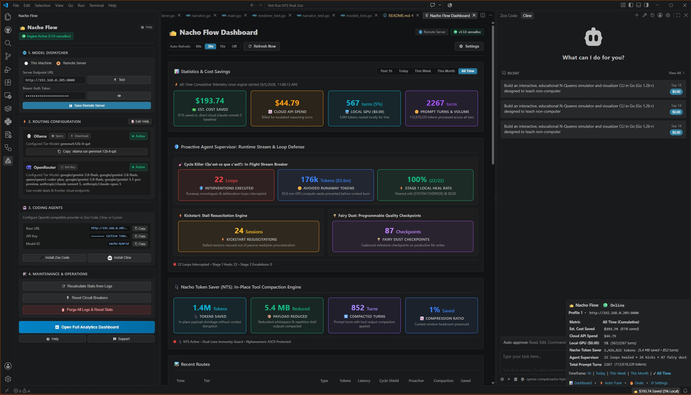

<p align="center">
  
</p>

# 🌮 Nacho Flow: VS Code Extension

<p align="center">
  <a href="https://marketplace.visualstudio.com/items?itemName=dixieflatline76.nacho-flow"></a>
  <a href="https://github.com/dixieflatline76/nacho-flow"></a>
  <a href="https://github.com/dixieflatline76/nacho-flow"></a>
  <a href="https://github.com/dixieflatline76/nacho-flow"></a>
  <a href="https://github.com/dixieflatline76/nacho-flow/blob/main/LICENSE"></a>
</p>

The VS Code companion extension for [Nacho Flow](https://github.com/dixieflatline76/nacho-flow) -- a hybrid model dispatcher and agent supervisor. Bundles the native Go binary directly. Zero CLI setup, zero Go toolchain required.

🌐 **Website & Docs**: [spicebox.dev/nacho-flow](https://spicebox.dev/nacho-flow/) · [GitHub](https://github.com/dixieflatline76/nacho-flow)

<p align="center">
  
</p>

---

## ⚡ 60-Second Quickstart

1. **Open the Nacho Flow Sidebar**: Click the **🌮 Nacho Flow** icon in the VS Code Activity Bar.
2. **Launch the Engine**: Under **1. Model Dispatcher**, click **`Start`**. Status turns `🟢 Engine Online`.
3. **Configure Your Agent**: Under **3. Coding Agents**, click **`Copy`** next to:
   - **Base URL**: `http://127.0.0.1:8000/v1`
   - **Model ID**: `nacho-hybrid`
   - *(Optional API Key: `sk-nacho-secret-key`)*
4. **Paste into Your Agent**: Open **Cline**, **Zoo Code**, or **Cursor** settings, set Provider to **OpenAI Compatible**, paste the copied values.

Routine turns run on your local GPU at full speed, while complex reasoning automatically escalates to cloud frontier models.

---

## ✨ Features

### 🛡️ Agent Supervision

- **Cycle Killer**: Kills repetitive N-gram loops in < 3s across reasoning, content, and tool lanes. Injects an immediate local override prompt to force a tool action. File writes are immune.
- **Kickstart (Read Slap & Thought Slap)**: Breaks analysis paralysis when agents get stuck in read-only loops (**Read Slap**) or hit `max_tokens` mid-monologue without emitting a tool call (**Thought Slap**). Injects a local steer prompt or escalates to a smarter tier (capped at 3 turns via anti-latching). Auto-suspends in Plan Mode.
- **Fairy Dust**: Deploys frontier models (Claude Sonnet 5.5, DeepSeek R1) every N writes for quality checkpoints—without running heavy models continuously.
- **Tool Normalizer**: Converts 8 malformed tool-call format families into standard OpenAI `tool_calls` JSON, eliminating 3-strike harness crashes from small local models.

### 🗜️ Nacho Token Saver (NTS)

- **Test Compaction**: Strips passing test noise in-place across Go, Cargo, Pytest, and Jest at wire speed (0 allocs, < 10 µs). Preserves all failures, diffs, panics, and summaries.
- **Reasoning Pruning**: Drops historical `<think>` blocks from older turns while keeping recent context fresh. Automatically migrates Anthropic cache breakpoints.
- **Pre-Routing Ingress**: Compacts prompts *before* tier selection so inflated test outputs don't trigger premature cloud escalations.
- **Terminal Sanitizer**: Resolves `\r` progress spinner spam in-place, purges ANSI escape codes, and deduplicates repeated tool/reminder loops.


---

### 🎛️ Sidebar Control Hub

- **Local / Remote Gateway**: 1-click Start, Stop, Restart, and live streaming logs for the bundled Go engine. Connect across LAN or Tailscale with optional Bearer Auth.
- **Routing Profiles & Action Toolbar**: Switch on the fly between built-in profiles (`profile1.yaml`, `profile2.yaml`, `profile3.yaml`) or create unlimited custom slots via **`＋` Add**, **`⧉` Clone**, **`✏️` Rename**, **`－` Delete**, **`🔍 Diff`**, and **`Reset`** with zero-downtime hot-reload:
  - **Profile 1 (Standard Hybrid Pipeline — Default)**: Universal gateway configuration for autonomous coding agents (Cline, Kilo, Zoo, Cursor, Aider):
    - *Core Coding Engine*: Fast cloud workhorse (`z-ai/glm-5.3-flash` Low, 2–4s), Turn 0 Low Architecture Kickoff, Tier 2 Debug High, Tier 3 De-escalation Max ($0.65/M).
    - *Kickstart Escalation Tier*: Automatically resuscitates agents trapped in read-only browsing loops by injecting `[SYSTEM OVERRIDE]` and routing to `google/gemini-3.8-flash` to force concrete file edits or test executions.
    - *Multimodal Vision Escapement Tier*: Routes screenshot turns (`Retries < 6 && HasImages`) to `google/gemini-3.8-flash` for high-speed visual state analysis without bloating the primary code generator context.
    - *Stream Defenses*: Cycle Killer, Nacho Token Saver (NTS), and Thought Slap rescue integration.
  - **Profile 2 (Deep Reasoning & Autonomous Benchmark)**: Tuned for deep chain-of-thought, complex algorithmic benchmarks, and runaway thought prevention:
    - *Turn 0 Architecture Kickoff*: Engages `z-ai/glm-5.3-flash` at **Max Reasoning** guarded by **`thought_slap: true`**. Rescues token budget truncations in **2.4 seconds** into valid tool calls, completely preventing terminal stalls.
    - *Tuned Cycle Killer*: 16k thinking token ceiling, 12-word n-gram window, and 20 max repeats to tolerate dense ASCII tables and probability matrices without premature kills.
    - *Fairy Dusting*: Tactical Code Reviews at turn 15 (high reasoning) and Strategic Architecture Audits at turn 60 (max reasoning).
    - *Proven Benchmark Record*: 89 turns, 14.6 minutes, 93% test coverage, 0 race conditions, 100% pass rate on full Las Vegas Blackjack Monte Carlo simulation.
  - **Profile 3 (Anthropic Native Benchmark)**: Direct first-party Anthropic Messages API pipeline (`https://api.anthropic.com`):
    - Zero intermediary proxy latency with native prompt caching (`cache_control`) and multimodal vision.
    - Claude Sonnet 5.5 Turn 0 Architecture → Claude Haiku 5.5 Fast Workhorse (Medium & High reasoning, guarded by real-time test failure inspection `!HasTestFail`) → Claude Sonnet 5.5 Error Escalation → Claude Sonnet 5.5 High Reasoning → Claude Opus 5.5 On-Demand override.
    - *Speed Record*: Completed full autonomous project build in **39 turns in 8.3 minutes** with a 100% test pass rate.
- **Provider Status**: Real-time health chips for local engines (llama.cpp, Ollama, vLLM) and cloud APIs (OpenRouter, DeepSeek, Anthropic).
- **Agent Setup**: 1-click copy for Base URL, API Key, and Model ID, plus 1-click Marketplace installers for **Zoo Code**, **Cline**, and **Kilo Code**.

---

### 🧠 Interactive YAML Config Assist

Edit any Nacho Flow profile or `config.yaml` with full IDE language intelligence:

- **Interactive CodeLenses**: Click **`Ping Endpoint`**, **`N tier reference(s)`**, **`Switch Provider`**, **`Choose Model`**, and **`Pick Rescue Tier`** directly above YAML blocks across `providers`, `tiers`, `default_tier`, `kickstart.thought_slap`, and `fairy_dust.entries`.
- **Live `/v1/models` Discovery & Autocomplete (`Ctrl+Space`)**: Queries live model lists from local (`llama.cpp`, `Ollama`, `vLLM`) and cloud (`OpenRouter`, `Anthropic`) endpoints with 60s caching, automatic `ENV_*` key resolution, and curated offline fallbacks.
- **Semantic Diagnostics, Quick Fixes & Pre-Flight Save Gate**: Catches unknown provider/tier references, unreachable tiers after `when: "true"`, invalid `when:` expressions, and tab indentation with 1-click Quick Fixes (`Ctrl+.`). Automatically pauses local engine restarts on save if validation errors exist.
- **LSP Navigation & Refactoring**: Supports **Go to Definition (`F12`)**, **Find All References (`Shift+F12`)**, **Rename Symbol (`F2`)** across provider and tier references, and **Document Outline (`Ctrl+Shift+O`)**.

---

### 📊 Real-Time Analytics Dashboard

Open with `Ctrl+Shift+P` -> `Nacho Flow: Show Dashboard`:

- **Financial Telemetry**: Total spend, savings ($, %), local GPU turns, cloud turns, billed vs. avoided tokens. Filter by Today, This Week, All Time.
- **Live Route Inspector**: Last 500 LLM requests -- token counts, latency, matched tier rule, provider, model, retry steps.
- **Auto-Tuner**: Click `Run Auto-Tuner` to replay `traffic.jsonl`, find optimal tier thresholds, and apply a green/red YAML diff with 1-click selective apply.

---

### 🔥 Heat Seeker: Live Model Deals

Scans 300+ cloud models on OpenRouter for flash discounts and free endpoints:

- Deal cards show discount %, prompt/completion pricing, tool support, and SWE-bench score.
- **1-Click Adopt**: Select a tier to replace, the extension backups `config.yaml`, updates the model, and hot-swaps with zero downtime.

---

### 🚦 Status Bar HUD

```text
🌮 Nacho Flow ● Online | $193.74 Saved All Time (5% Local)
```

Hover for active profile, cost metrics, supervisor defense telemetry, and NTS stats. Click for a QuickPick menu: open dashboard, switch presets, start/stop/restart, open `config.yaml`.

---

### 🌶️ In-Chat Directives (`@nacho:`)

Override routing directly from your prompt in Zoo Code, Cline, or Cursor:

| Directive | Type | Effect |
| :--- | :--- | :--- |
| `@nacho:toggles` | Inspection | Show live session switches |
| `@nacho:status` | Inspection | Show daemon uptime, spend, savings |
| `@nacho:reset` | Management | Hard reset session & restore defaults |
| `@nacho:kickstart-off` / `on` | Switch | Suspend / resume Kickstart |
| `@nacho:cyclekiller-off` / `on` | Switch | Suspend / resume Cycle Killer |
| `@nacho:shield-off` / `on` | Switch | Suspend / resume tool-call synthesis |
| `@nacho:raw-on` / `off` | Switch | Enable / disable raw SSE stream |
| `@nacho:fairydust-off` / `on` | Switch | Suspend / resume frontier checkpoints |
| `@nacho:local` | Single Turn | Force Local GPU tier |
| `@nacho:cloud` | Single Turn | Force Cloud Fallback tier |
| `@nacho:reasoning` | Single Turn | Force DeepSeek R1 / o3 |

---

## ⌨️ Command Palette

All features via `Ctrl+Shift+P` / `Cmd+Shift+P`:

| Command | Identifier |
| :--- | :--- |
| Show Dashboard | `nacho-flow.showDashboard` |
| Open Controls in Sidebar | `nacho-flow.openSettings` |
| Open Configuration (`config.yaml`) | `nacho-flow.openConfig` |
| Switch Profile | `nacho-flow.switchProfile` |
| Add New Profile (`＋`) | `nacho-flow.addProfile` |
| Clone Active Profile (`⧉`) | `nacho-flow.cloneProfile` |
| Rename Active Profile (`✏️`) | `nacho-flow.renameProfile` |
| Delete Profile (`－`) | `nacho-flow.deleteProfile` |
| Compare Profile with Factory Template | `nacho-flow.compareProfileWithTemplate` |
| Reset Profile to Factory Default | `nacho-flow.resetProfileToDefault` |
| Switch Provider (CodeLens) | `nacho-flow.pickProvider` |
| Choose / Pick Model (`/v1/models`) | `nacho-flow.pickModel` |
| Pick Rescue Tier (CodeLens) | `nacho-flow.pickRescueTier` |
| Ping Provider Endpoint (CodeLens) | `nacho-flow.pingProviderEndpoint` |
| Find Provider References (CodeLens) | `nacho-flow.findProviderReferences` |
| Run Auto-Tuner & Optimize Routing | `nacho-flow.runOptimizer` |
| Refresh Heatseeker Deals | `nacho-flow.refreshDeals` |
| Reset Circuit Breakers | `nacho-flow.resetCircuit` |
| Refresh Statistics | `nacho-flow.refreshStats` |
| Set Bearer Auth Token | `nacho-flow.setAuthToken` |

---

## ⚙️ Extension Settings

| Setting | Default | Description |
| :--- | :--- | :--- |
| `nachoFlow.engineMode` | `"local"` | `'local'` runs the embedded daemon; `'remote'` connects to an external gateway |
| `nachoFlow.daemonUrl` | `http://127.0.0.1:8000` | URL of the local Nacho Flow daemon |
| `nachoFlow.remoteDaemonUrl` | `http://192.168.0.205:8000` | URL of the remote Nacho Flow daemon server (LAN / Tailscale) |
| `nachoFlow.authToken` | `""` | Optional Bearer Auth Token for protected remote gateways |
| `nachoFlow.autoStartDaemon` | `true` | Auto-resume the local binary on VS Code launch if previously running |
| `nachoFlow.localVramGB` | `16` | Local GPU VRAM limit in GB for auto-tuning routing thresholds (`0` for unconstrained) |

---

## 📚 Documentation

- **Official Website**: [spicebox.dev/nacho-flow](https://spicebox.dev/nacho-flow/)
- **Extension User Guide**: [spicebox.dev/nacho-flow/docs.html?doc=extension_guide](https://spicebox.dev/nacho-flow/docs.html?doc=extension_guide)
- **Core Engine & CLI Guide**: [spicebox.dev/nacho-flow/docs.html?doc=user_guide](https://spicebox.dev/nacho-flow/docs.html?doc=user_guide)
- **GitHub Repository**: [github.com/dixieflatline76/nacho-flow](https://github.com/dixieflatline76/nacho-flow)

---

## 🌮 Support Nacho Flow

If Nacho Flow saved your sanity or your API bill:

- Grab a copy of **Spice** on the [Mac App Store](https://apps.apple.com/us/app/spice-wallpaper-manager/id6760980759?mt=12) or [Microsoft Store](https://apps.microsoft.com/detail/9NPBQ3C91WPF) -- you get a native desktop utility and it funds continued development.
- On Linux? [Star Nacho Flow on GitHub](https://github.com/dixieflatline76/nacho-flow).

---

## 📄 License

- The VS Code Companion Extension is open source under the **[MIT License](https://github.com/dixieflatline76/nacho-flow/blob/main/LICENSE)**.
- The core Nacho Flow gateway daemon is licensed under **GNU AGPL-3.0** with API Interoperability Exception.