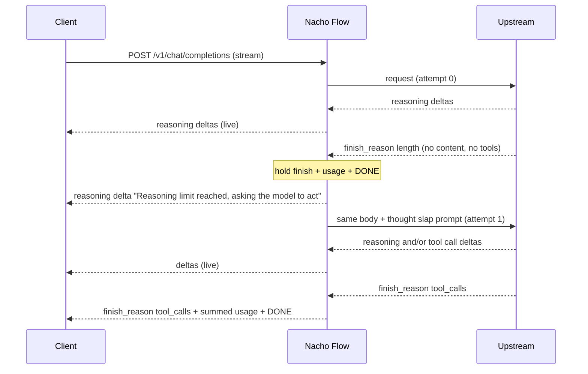
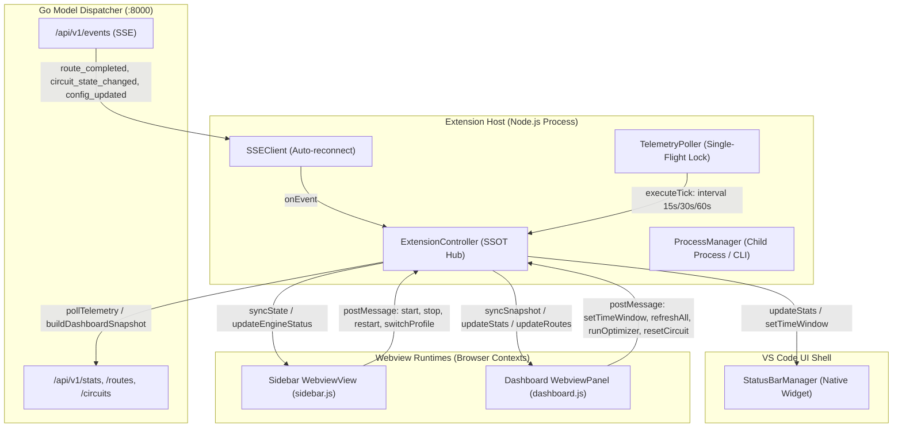

# Kickstart Read Slap & Thought Slap — Implementation Plan

> **Status**: DRAFT — for review. No implementation until approved.
> **Release type**: ⚠️ **Breaking config change** (clean break, no legacy aliases).
>
> **Framing**: Kickstart has two independent slaps.
> - **Read slap** (existing behavior, restructured config): the agent *reads with no writes* across N turns → Nacho adds a prompt to the client's next request. Global on/off.
> - **Thought slap** (new): the agent *thinks with no action* in a single turn — upstream stops on `finish_reason: "length"` with reasoning only (no content, no tool calls) → Nacho makes one more upstream call inside the same client request and splices the result into the same stream. Opt-in per tier.
>
> **Core Value**: An empty, length-truncated turn currently kills the autonomous loop (or worse, gets disguised as success). Observed cost: Cline Blackjack benchmark, ~32k reasoning tokens, ~10 minutes, then a fake "verification completed" message and a stalled session.

---

## 1. Problem Statement

### 1.1 Observed failure
- Model: `z-ai/glm-5.3-flash` via OpenRouter, Cline 4.1.23 in Plan Mode (editor tool stripped).
- The model reasoned for ~32k tokens without emitting content or a tool call. Upstream terminated with `finish_reason: "length"`.
- The client received a fabricated assistant message and the session stopped.

### 1.2 What Nacho Flow does today (verified in code)
| Step | Location | Behavior |
|---|---|---|
| Upstream finish chunk | [stream_normalizer.go L498-L557](../pkg/server/stream_normalizer.go) | `finish_reason: "length"` chunk is **forwarded verbatim** to the client. Finish reason is **not recorded** anywhere. |
| `[DONE]` | [stream_normalizer.go L807-L814](../pkg/server/stream_normalizer.go) | If `!hasEmittedContent && !hasEmittedToolCalls && hasEmittedReasoning`, append `silent_turn_message` from [data/reasoning.json L53](../data/reasoning.json) (`"Review and codebase verification completed..."`) **plus a second** `finish_reason: "stop"` chunk. |
| Telemetry | [telemetry.go L138-L168](../pkg/server/telemetry.go) | No signal exists for truncation → classified `FailureNone` (success). |

Resulting client byte stream today:
```
reasoning… → finish_reason:"length" → content:"Review and codebase verification completed…" → finish_reason:"stop" → [DONE]
```
Defects:
1. **Malformed stream** — two finish chunks.
2. **Fabricated assistant text** — persisted into client history; the model later "remembers" verifying things it never did.
3. **Telemetry blind** — `length` truncation recorded as success.
4. **Same double-finish defect** exists when Agent Shield synthesizes a tool call ([emitSyntheticToolCall](../pkg/server/stream_normalizer.go) appends `finish_reason:"tool_calls"` after upstream's finish was already forwarded).

### 1.3 Why read slap cannot catch this
Agent clients continue autonomously only when a turn ends in a tool call. A turn with no tool call ends the loop (Zoo auto-nudges with a "you did not use a tool" message; Cline 4.1.23 and Kilo 7.8.8 are unverified). Read slap only acts on the client's **next** request — which never arrives. Read slap also auto-suspends when the client has no write tools ([pipeline.go L260-L263](../pkg/server/pipeline.go)), which is exactly the Plan Mode situation where this failure occurred.

Before `[DONE]` the response is still open, so the turn is still Nacho's to finish.

---

## 2. Goals and Non-Goals

### Goals
- G1. Never fabricate assistant content; never emit more than one finish chunk.
- G2. Record truncation truthfully in telemetry.
- G3. Thought slap: opt-in per tier (and per Fairy Dust entry), same-turn recovery.
- G4. Zero knowledge of client mode, client tool schemas, or model parameter dialects.
- G5. Bounded cost: hard caps on extra upstream calls.
- G6. No measurable regression on the zero-allocation hot path.
- G7. Read slap runtime behavior unchanged; only its config shape changes.
- G8. Old config keys fail loudly with a migration message (no silent disable).

### Non-Goals
- N1. **No mode detection.** Nacho never claims "planning" or any other phase.
- N2. **No reasoning parameter overrides.** No injected `reasoning_effort`, budgets, or `max_tokens`. Changing model settings for the recovery call is only possible by pointing to another tier the user defined (`rescue_tier`).
- N3. **No synthetic tool calls** to regain a turn (rejected: unknown client auto-approve state, history pollution, per-client schemas).
- N4. `length` during **tool-call argument streaming** (truncated JSON) — out of scope; pass through untouched.
- N5. `length` after **partial prose** — out of scope; pass through untouched.
- N6. **No per-tier read slap.** Read slap is session-level and decided before tier selection.
- N7. **No granular session toggles.** `@nacho:kickstart-off/on` covers both slaps.

---

## 3. Terminology

| Term | Definition |
|---|---|
| **Read slap** | N consecutive turns without write progress → prompt added to the client's next request. Global. |
| **Thought slap** | Empty truncated turn → recovery call within the same client request. Opt-in per tier. |
| **Empty truncated turn** | Upstream `finish_reason == "length"` AND no tool-call deltas AND no non-whitespace content. Reasoning may or may not be present. |
| **Recovery call** | The extra upstream call a thought slap makes; its output is spliced into the same SSE response. |
| **Held terminal** | The upstream finish chunk, any trailing usage-only chunks, and `[DONE]`, buffered by the normalizer instead of being written to the client. |
| **Attempt** | One recovery call. `max_attempts` bounds them per client request. |

---

## 4. Design Overview



### 4.1 The two slaps side by side

| | Read slap | Thought slap |
|---|---|---|
| Symptom | Reads with no writes | Thinks with no action |
| Time scale | Cross-turn (N turns) | Single turn |
| Trigger | `threshold` consecutive turns without write progress | Upstream `length` + no content + no tool calls |
| Evaluated | Before tier selection, on the inbound request | After the tier ran, at end of stream |
| Acts on | The client's next request | A new upstream call Nacho makes within the current request |
| Upstream calls per client request | 1 | 1 + `max_attempts` |
| Enablement | Global `enabled` | Opt-in per tier / Fairy Dust entry |
| Plan Mode (no write tools) | Auto-suspends | **Active** (this is where the failure happens) |
| Session counter | `SessionReadSlapCount` | `SessionThoughtSlapCount` (separate) |

### 4.2 Relationship to Cycle Killer
Cycle Killer detects pathological output and severs it. Before the first 2KB reach the client it retries invisibly; after that it writes "Loop Detected… reply continue" + `stop`, which ends the client loop — the same dead end thought slap addresses. Phase 5 optionally hands thinking-lane severances to the thought slap recovery call.

---

## 5. Configuration (target shape)

### 5.1 Global
```yaml
kickstart:
  read_slap:
    enabled: true
    threshold: 5                  # slap after N consecutive turns without write progress
    max_slaps: 10                 # per session; then force-escalate to default tier
    max_failures: 3               # circuit breaker: stop slapping after N consecutive failed slaps
    write_only: true              # only file writes / commands count as progress
    # custom_write_tools: []      # optional
    # prompt_override: ""         # optional

  thought_slap:                   # optional global defaults for tiers that opt in; does nothing on its own
    max_attempts: 1               # recovery calls per turn (default 1)
    rescue_tier: ""               # optional: run the recovery call on another tier (default: same tier)
    prompt_override: ""           # optional: replace the default recovery prompt
```

The whole `kickstart.thought_slap` block is optional. If omitted, built-in defaults apply (`max_attempts: 1`, same tier, default prompt).

### 5.2 Per tier — opt-in and overrides
Any of the three global defaults can be overridden per tier. Fields not set on the tier fall back to `kickstart.thought_slap`, then to built-in defaults.

```yaml
tiers:
  - name: "Turn 0 Architecture Kickoff"
    model: "z-ai/glm-5.3-flash"
    reasoning_effort: "high"
    thought_slap: true            # opt in, use kickstart.thought_slap defaults

  - name: "Tier 2: Debug & Reasoning"
    model: "z-ai/glm-5.3-flash"
    reasoning_effort: "high"
    thought_slap:                 # opt in + override any or all defaults
      max_attempts: 2
      rescue_tier: "Tier 1: Fast Coding Workhorse"
      prompt_override: "Stop reasoning. Call a tool now."

  - name: "Tier 3: De-escalation"
    model: "z-ai/glm-5.3-flash"
    reasoning_effort: "max"
    thought_slap:                 # opt in + override one default, inherit the rest
      rescue_tier: "Tier 2: Debug & Reasoning"

  - name: "Tier 1: Fast Coding Workhorse"
    model: "z-ai/glm-5.3-flash"
    reasoning_effort: "low"
    # no thought_slap key → off
```

Resolution order per field: **tier override → `kickstart.thought_slap` → built-in default**.

Accepted forms for `thought_slap` on a tier / Fairy Dust entry:
| Form | Meaning |
|---|---|
| key absent | off |
| `thought_slap: true` | on, global defaults |
| `thought_slap: false` | off (convenience for toggling while editing) |
| `thought_slap: { … }` (mapping, any fields) | on, fields override global defaults |
| `thought_slap:` (empty / null) | **config error**: *"thought_slap needs a value: use `thought_slap: true` or a block of overrides"* |

Rationale: `true` and a mapping are unambiguous, valid YAML, and read naturally. A bare key is valid YAML but parses as `null`, which looks like "on" to a human and "absent" to most parsers — rejecting it with a clear message avoids silent surprises.

### 5.3 Fairy Dust entries
Fairy Dust turns remain strictly isolated (`reqCtx.NoKickstart = true`). Neither read slap nor thought slap applies to Fairy Dust checkpoint turns. No config fields are added to `FairyDustEntry`, avoiding synthetic tier mutation complexities in the pipeline.

### 5.4 Breaking changes (clean break)
| Old key | New key / fate |
|---|---|
| `kickstart.enabled` | `kickstart.read_slap.enabled` |
| `kickstart.threshold` | `kickstart.read_slap.threshold` |
| `kickstart.max_count` | `kickstart.read_slap.max_slaps` |
| `kickstart.max_failures` | `kickstart.read_slap.max_failures` |
| `kickstart.write_only` | `kickstart.read_slap.write_only` |
| `kickstart.write_tools`, `kickstart.custom_write_tools` | `kickstart.read_slap.custom_write_tools` |
| `kickstart.prompt` | `kickstart.read_slap.prompt_override` |
| `cycle_killer.kickstart_*`, `cycle_breaker.kickstart_*` (all 7 legacy fields) | **removed** |
| DSL `SessionKickstarted`, `SessionKickstartCount` | `SessionReadSlapped`, `SessionReadSlapCount` (Decision D4) |

**Loud failure**: the loader uses plain `yaml.Unmarshal` ([config.go L67](../pkg/config/config.go)), which silently ignores unknown keys — old configs would silently disable read slap. Add a targeted legacy-key check that fails startup with: *"Config uses removed key `kickstart.threshold`; move it to `kickstart.read_slap.threshold`. See CHANGELOG vX.Y."* Same for DSL variables in `when` expressions (validated at tier compile time).

---

## 6. Phased Implementation

Each phase is independently shippable and reviewable.

### 6.0 Safety Strategy (applies to every phase)

The execution path is fragile: one small change has repeatedly broken end-to-end agent flows. The strategy is **freeze current behavior first, then change only what is provably isolated, then prove nothing else moved.**

**S1. Freeze behavior before touching code (Phase 0)**
- **Real-traffic corpus**: capture raw upstream SSE responses *outside* Nacho Flow using an external capture proxy (provider `base_url` → local proxy → OpenRouter / Anthropic). Zero Nacho code change. Cover: Cline, Kilo, Zoo; GLM, Gemini, Anthropic; native tool calls, XML tool calls, inline `<think>`, Shield-synthesized calls, Cycle Killer trips, long writes.
- **Normalizer golden replay**: every corpus stream is replayed through `StreamNormalizer`; output bytes must be **identical** to the frozen baseline. The only allowed diffs are the fixtures explicitly listed in a phase's exit criteria.
- **Routing golden replay**: replay recorded request bodies (outbound dumps via `NACHO_DUMP_OUTBOUND`, Blackjack sessions) through classifier + pipeline without an upstream; assert identical tier selection and identical injected request bytes.

**S2. Shrink blast radius by design**
- **New logic runs only on the rare path.** The normalizer holds the finish chunk *only* when the turn is still empty (no content, no tool calls) at the moment the finish arrives. Every normal turn takes exactly today's code path, byte- and timing-identical.
- **Additive normalizer changes only.** New fields and accessors; one new branch at finish detection, gated by a cheap byte check. No existing branch is rewritten.
- **No refactor of `dispatchTier`.** The recovery call lives in a new file (`thought_slap.go`) with its own small upstream helper, accepting some duplication. The only edit to `dispatch_stream.go` is a single hook after the streaming loop: `if normalizer.TerminalHeld() { ... }`, which can only be true when the tier opted in.
- **Behavior changes and refactors never share a PR.** The config restructure (Phase 2) ships alone with zero behavior change.
- **Out-of-scope fixes are deferred**, even if adjacent (e.g. Shield double-finish, see §6.7).

**S3. Test gates per PR (all must pass)**
- `go test ./...` and `go test -race ./pkg/server/... ./pkg/router/...`.
- Normalizer and routing golden replays: zero unexpected diffs.
- **Existing test expectations are frozen.** Any change to an existing assertion must be listed in the PR description with a reason; unlisted changes block the PR.
- `benchstat` on `BenchmarkStreamNormalizer*` and proxy benchmarks: no regression in allocs/op; ns/op within noise.

**S4. Live gates per behavior-changing phase (1b, 3)**
- Tag a baseline commit and keep the baseline VSIX installed side by side (existing practice: `nacho-flow-1.5.0-<label>` builds).
- Blackjack A/B on Kilo, Zoo, and Cline vs baseline: turns, wall time, cost, failure categories, Cycle Killer trips, read slap counts. Any metric outside the baseline's run-to-run spread blocks the phase.

**S5. Detect before acting**
- Phase 1a ships detection and telemetry only, with no client-visible change. Run real sessions for a few days and confirm `empty_truncated_turn` fires exactly where expected (and never on healthy turns) before any output changes.

**S6. Rollback**
- Each phase is one revertable PR and one labeled VSIX.
- Thought slap is off unless a tier opts in; removing the opt-in is an instant disable with no rebuild.
- Roll back to any milestone: `code --install-extension dist\nacho-flow-1.5.0-<label>.vsix --force`, then reload the window.

**S7. Manual milestone testing in VS Code**
- After every milestone, I stop and you test manually before the next phase starts.
- Deploy with [deploy_local_vsix.bat](../deploy_local_vsix.bat) and the milestone's label (Appendix C), e.g. `deploy_local_vsix.bat ks-p1a-detect`. The script stamps `1.5.0-<label>` into both the VSIX and the Go binary (`-X main.version`).
- **Confirm the new build is live** (all three must show `1.5.0-<label>`; a mismatch means an old daemon is still running):
  1. VS Code Extensions panel → Nacho Flow version.
  2. In any agent chat, send `@nacho:status` → "Version & Uptime" line (zero cost, no upstream call).
  3. `curl http://127.0.0.1:8000/health` → `"version"`.
- Label rules: lowercase letters, digits, and hyphens only (must stay valid semver pre-release). Pattern: `ks-p<phase>-<what>`, with `-r2`, `-r3` suffixes for fix rebuilds of the same milestone.
- Each milestone has a short checklist (Appendix C). A milestone passes only when you sign it off.

**S8. TDD Protocol & Zero-Allocation Invariant**
- **Strict TDD**: In every phase, write tests and golden fixtures first. Verify red (failing test reproducing current/expected behavior), implement minimal code to achieve green, then run refactor/benchmarks.
- **Zero/Low Allocations**: Use package-level byte markers (`finishReasonMarker = []byte("\"finish_reason\":")`) and gate unmarshaling behind byte checks. Normal prose and tool chunks must experience 0 additional heap allocations (0 B/op). Buffers for held terminals must come from `bufPool`. Verify via `go test -benchmem -run=^$ -bench=BenchmarkStreamNormalizer ./pkg/server/...`.

### Phase 0 — Baseline, fixtures, and client behavior matrix (no behavior change)

**Deliverables**
1. **SSE fixtures** (`pkg/server/testdata/truncation/*.sse`):
   | Fixture | Sequence |
   |---|---|
   | `F1_reasoning_length` | reasoning → `length` → usage → `[DONE]` |
   | `F2_reasoning_stop_empty` | reasoning → `stop` → `[DONE]` |
   | `F3_whitespace_content_length` | reasoning → content `"\n\n"` → `length` |
   | `F4_partial_toolcall_length` | reasoning → tool-call deltas (unterminated args) → `length` |
   | `F5_partial_prose_length` | reasoning → prose → `length` |
   | `F6_usage_in_finish_chunk` | finish chunk carrying `usage` in the same payload |
   | `F7_no_reasoning_length` | no reasoning, no content → `length` |
   | `F8_anthropic_max_tokens` | Anthropic upstream translated by [anthropic.go L872](../pkg/provider/anthropic.go) (`max_tokens` → `length`) |
   | `F9_inline_think_length` | inline `<think>` tags in content (normalizer-routed reasoning) → `length` |
2. **Golden tests** capturing current (defective) output for F1–F9, so Phase 1 diffs are explicit.
3. **Cheap repro**: replay the captured Cline request body against OpenRouter with a small client `max_tokens` (e.g. 2,000) to trigger F1 in seconds instead of minutes. Document the command in Appendix A.
4. **Client behavior matrix** (manual, recorded in Appendix B): for Cline 4.1.23, Kilo 7.8.8, Zoo 3.88, observe reaction to:
   - (a) empty turn + `length` (no notice)
   - (b) empty turn + `stop`
   - (c) reasoning-field notice + `length`
   - (d) content-field notice + `length`
   - (e) mid-stream second `role:"assistant"` delta and a changed chunk `id` (splice compatibility)
   - (f) SSE comment lines (`: keepalive`) mid-stream
   - (g) empty assistant message persisted → next request shape (does the client send `content: ""` / `[]`?)
5. **Real-traffic corpus + normalizer golden replay** (S1).
6. **Routing golden replay** (S1).
7. **Baseline tag + baseline VSIX** (S4, S6): built from the untouched runtime with label `ks-p0-baseline`.
8. **Mock upstream for manual tests** (`scripts/mock_upstream`, test tooling only, not shipped): a tiny local OpenAI-compatible server that replays fixture streams by model name, scripted per call within a request, e.g. model `mock/f1-then-toolcall` returns F1 on the first call and a tool call on the second. Configured as a `local` provider in a test profile so you can trigger the rare path on demand in VS Code instead of waiting for a real 32k-token truncation.

**Exit criteria**: fixtures, corpus, and both golden replays merged and green; matrix filled for at least Cline and Zoo; baseline tagged.

---

### Phase 1 — Truthful termination (stop eating `length`)

Split into two PRs per S5:
- **1a — Detection only**: items 1 and 5–7 below. Zero client-visible change; normalizer golden replay must be 100% identical.
- **1b — Output change**: items 2–4. Only fixtures F1, F2, F7, F8, F9 may change in the golden replay.

**Changes**
1. **Finish tracking in normalizer** ([stream_normalizer.go](../pkg/server/stream_normalizer.go))
   - New fields: `finishReason string`, `hasNonWhitespaceContent bool`.
   - Detect finish on all paths, including `fastPassProse` (which currently forwards lines unparsed). Gate parsing behind `bytes.Contains(payload, "\"finish_reason\":\"")` to keep the hot path allocation-free.
   - Accessors: `FinishReason() string`, `IsEmptyTruncatedTurn() bool`.
2. **Hold the terminal only for empty turns**
   - If the finish chunk arrives while the turn is still empty (no content, no tool calls), **hold** it and every subsequent line (usage-only chunks) in `heldTerminal` until `[DONE]` (or EOF without `[DONE]`).
   - Turns that already emitted content or tool calls are untouched: finish forwarded immediately, exactly as today.
   - At `handleDone` for a held turn, exactly one of: (a) flush held terminal unchanged, (b) Phase 1 terminal notice for `length`, (c) Phase 3 recovery (held terminal deferred to dispatch).
3. **Silent turn resuscitation gating**
   - Never runs when `finishReason == "length"` (or any reason other than `stop`).
   - Behavior for `stop` + empty → **Decision D1**.
4. **Terminal notice for empty truncated turns** (when thought slap is off or exhausted)
   - Emit a single notice, preserve `finish_reason: "length"`.
   - Text (no mode claims): *"Model reached its output token limit (≈N reasoning tokens) without producing a response."*
   - Field (reasoning vs content) → **Decision D2**, informed by Phase 0 matrix rows (c)/(d).
5. **Telemetry**
   - `contract.RequestContext`: `UpstreamFinishReason string`, `EmptyTruncatedTurn bool`.
   - `telemetry.FailureCategory`: add `FailureReasoningTruncated = "reasoning_truncated"`.
   - [ClassifyTurnFailure](../pkg/server/telemetry.go): insert after `CycleBreakerTriggered` (Cycle Killer remains the more specific cause when both apply).
   - Traffic log record ([sink.go](../pkg/telemetry/sink.go)): `upstream_finish_reason`, `empty_truncated_turn`.
6. **Unary path** ([dispatch_unary.go](../pkg/server/dispatch_unary.go)): record `finish_reason` and classify; no content fabrication exists there today.
7. **Raw pass-through** (`FeatureRawPassThrough`): unchanged — raw means raw; finish tracking only.

**Risk to verify**: removing fabricated content means some clients may persist an assistant message with empty content. Anthropic upstreams reject empty content with HTTP 400. Confirm the NTS empty-content guard (see [HISTORICAL_REASONING_STRIPPING_PLAN.md §3.1](HISTORICAL_REASONING_STRIPPING_PLAN.md)) applies even when reasoning stripping is disabled, or add an equivalent guard in the Anthropic adapter. Matrix row (g).

**Tests**
- Goldens for F1–F9 flipped to the new expected output.
- Invariant test: every truncation fixture produces exactly one `finish_reason` and exactly one `[DONE]` (Shield-synthesized turns excluded until the deferred fix in §6.7).
- `ClassifyTurnFailure` table test for the new category.
- Benchmarks: `BenchmarkStreamNormalizer*` show 0 additional allocs/op on non-finish lines.

**Exit criteria**: no fabricated content after `length`; single-finish invariant holds across all fixtures; telemetry shows `reasoning_truncated` on F1/F7/F8/F9.

---

### Phase 2 — Config restructure (⚠️ breaking; no new runtime behavior)

**Schema** ([contract/interfaces.go](../pkg/contract/interfaces.go))
```go
type KickstartConfig struct {
    ReadSlap    ReadSlapConfig    `yaml:"read_slap,omitempty" json:"read_slap,omitempty"`
    ThoughtSlap ThoughtSlapConfig `yaml:"thought_slap,omitempty" json:"thought_slap,omitempty"`
}

type ReadSlapConfig struct {
    Enabled          *bool    `yaml:"enabled,omitempty" json:"enabled,omitempty"`
    Threshold        int      `yaml:"threshold,omitempty" json:"threshold,omitempty"`
    MaxSlaps         int      `yaml:"max_slaps,omitempty" json:"max_slaps,omitempty"`
    MaxFailures      int      `yaml:"max_failures,omitempty" json:"max_failures,omitempty"`
    WriteOnly        bool     `yaml:"write_only,omitempty" json:"write_only,omitempty"`
    CustomWriteTools []string `yaml:"custom_write_tools,omitempty" json:"custom_write_tools,omitempty"`
    PromptOverride   string   `yaml:"prompt_override,omitempty" json:"prompt_override,omitempty"`
}

type ThoughtSlapConfig struct {
    MaxAttempts    int    `yaml:"max_attempts,omitempty" json:"max_attempts,omitempty"`
    RescueTier     string `yaml:"rescue_tier,omitempty" json:"rescue_tier,omitempty"`
    PromptOverride string `yaml:"prompt_override,omitempty" json:"prompt_override,omitempty"`
}

// ThoughtSlapOptIn is the per-tier / per-Fairy-Dust-entry field.
// Custom UnmarshalYAML accepts: bool, mapping (implies enabled); rejects null.
// MarshalYAML / MarshalJSON emit `true` when no overrides are set, else the mapping.
type ThoughtSlapOptIn struct {
    Enabled   bool
    Overrides ThoughtSlapConfig
}

// Tier gains:
//     ThoughtSlap *ThoughtSlapOptIn `yaml:"thought_slap,omitempty" json:"thought_slap,omitempty"`
// (Fairy Dust turns remain isolated and do not gain thought_slap)
```
- Remove `KickstartThreshold`, `KickstartWriteOnly`, `WriteTools`, `KickstartWriteTools`, `KickstartPrompt`, `KickstartMaxCount`, `KickstartMaxFailures` from `CycleBreakerConfig`, and all fallback chains that read them in [pipeline.go L226-L289](../pkg/server/pipeline.go) and [pipeline.go L457-L464](../pkg/server/pipeline.go). (Note: confirm `CycleBreakerConfig.WriteTools` is only used by Kickstart before removing.)
- `resolveThoughtSlap(optIn, global) (cfg ThoughtSlapConfig, enabled bool)`: per-field override, defaults applied last.
- Update `pkg/tuner/*` (`ast_helpers.go`, `conflict_evaluator.go`, `multi_tier_replay.go`, `ast_differential_test.go`, `min_conflicts_test.go`) to recognize `SessionReadSlapped` and `SessionReadSlapCount` in rule synthesis and AST conflict analysis.

**Defaults**
| Field | Default |
|---|---|
| `read_slap.enabled` | `false` when the block is absent |
| `read_slap.threshold` | `5` |
| `read_slap.max_slaps` | `10` |
| `read_slap.max_failures` | `3` |
| `thought_slap.max_attempts` | `1` (validation range `1..3`) |
| `thought_slap.rescue_tier` | `""` → same tier |
| `thought_slap.prompt_override` | `""` → `contract.DefaultThoughtSlapPrompt` |

Default thought slap prompt (mode-neutral):
> *"Your previous attempt reached the output token limit while reasoning and produced no response. Do not restart your analysis. Respond now using the tools available to you."*

Default client-visible notice (fixed text, not configurable — keeps config small):
> *"Reasoning limit reached — asking the model to respond."*

**Validation** ([config/validation.go](../pkg/config/validation.go))
- Legacy keys → startup error with migration message (§5.4).
- Legacy DSL variables in `when` → startup error with migration message.
- `thought_slap:` null → error (§5.2).
- `read_slap.threshold >= 1` when enabled.
- `max_attempts` in `1..3`.
- `rescue_tier` must name an existing tier or `default_tier`.
- Recovery calls never chain: when a recovery call runs on `rescue_tier: X`, X's own `thought_slap` is ignored.

**Shipped config updates**: [template.go](../pkg/config/template.go), `config.yaml`, `extension/resources/profiles/profile{1,2,3}.yaml`, and the active user profile.

**Tests**: YAML round-trip for each opt-in form, null rejection, override precedence table, legacy-key errors (one per removed key), legacy DSL variable errors, hot-reload, read slap runtime tests unchanged except for config fixtures.

**Exit criteria**: new config parses/validates/resolves; old config fails with actionable messages; read slap behavior identical.

---

### Phase 3 — Thought slap recovery (core)

**3.1 Gating**
A thought slap runs only if all hold:
- the target tier opted in via `thought_slap`;
- `!reqCtx.NoKickstart` (`@nacho:kickstart-off` disables both slaps; Fairy Dust turns also set `reqCtx.NoKickstart = true` and remain strictly isolated);
- **not** subject to read slap's Plan Mode auto-suspend (`HasWriteCapability == false` must not disable thought slap).

**3.2 Normalizer: deferred terminal**
- `SetDeferTerminal(true)` when thought slap is active for the request.
- On `[DONE]`: if `IsEmptyTruncatedTurn()`, do **not** write held terminal; set `TerminalHeld() == true` and expose `HeldTerminal() []byte` plus captured usage.
- Otherwise identical to Phase 1.

**3.3 Recovery upstream call** (new file `pkg/server/thought_slap.go`)
- A small standalone helper performs provider lookup, circuit-breaker check, `preparePayload`, `buildOutboundRequest`, and `RoundTrip` for the recovery call. `dispatchTier` is **not** refactored (S2); the duplication is accepted to keep the existing path untouched.
- After SSE headers are sent, nothing may call `http.Error` or write headers. All post-header failures must be expressed as SSE.

**3.4 Recovery loop** ([dispatch_stream.go](../pkg/server/dispatch_stream.go), after the main streaming loop)
*Note on Peek Buffer Timing*: In `dispatch_stream.go`, even if an empty turn is <2KB and EOF is encountered during the peek buffer loop, HTTP headers (`w.WriteHeader(resp.StatusCode)`) are sent before reaching this point. Hence, headers are always committed and recovery always splices directly into the open SSE stream.

```
attempts := 0
for normalizer.TerminalHeld() && attempts < cfg.MaxAttempts && r.Context().Err() == nil && withinHardCap():
    write notice reasoning chunk to w; flush
    recBody := injectCorrectionPrompt(body, prompt)           // original body, pre-preparePayload
    recTier := cfg.RescueTier resolved (Option A), else targetTier
    resp, prov, err := thoughtSlapUpstream(...)
    if err or non-2xx: break with outcome=upstream_error
    recNorm := NewStreamNormalizer(wrapResponseStream(resp, prov))
        SetCycleBreaker(fresh from recTier config)             // Cycle Killer still protects the recovery call
        SetDeferTerminal(true); SetSuppressPrelude(true)       // drop role-only first delta
    stream recNorm → w (no peek window; headers already sent)
    accumulate usage (sum PromptTokens, CompletionTokens, TotalTokens, Cost)
    attempts++
    normalizer = recNorm
emit final terminal:
    if last call produced actionable output → its own finish
    else → Phase 1 terminal notice + finish_reason "length"
    + summed usage chunk (Decision D3) + [DONE]
```

**3.5 Wire details**
- **Prelude suppression**: drop the recovery call's role-only first delta. Chunk `id` rewriting only if Phase 0 matrix row (e) shows a client depends on it.
- **Keepalive** (Decision D6): while waiting for the recovery call's first byte, emit `: keepalive\n\n` SSE comments every 10s, only if matrix row (f) shows all target clients ignore comments.
- **Client cancel**: check `r.Context().Err()` before each attempt; propagate cancellation to the upstream request.

**3.6 Cost bounding**
- Per-request hard cap on upstream calls: `1 + cycle_killer.max_retries + thought_slap.max_attempts`, additionally capped at a global constant (proposal: 4). Decision D5.
- Usage summed across attempts for telemetry and pricing.

**3.7 Session state and counters**
- Separate counters (resolved): thought slaps never touch read slap state (`RecordKickstartState`, `SessionReadSlapped`, `SessionReadSlapCount`, `max_slaps` force-escalation, `RecordKickstartFailure`).
- New session counter `SessionThoughtSlapCount` (used by Phase 4).

**3.8 Telemetry**
- RequestContext: `ThoughtSlapAttempts int`, `ThoughtSlapOutcome string` (`recovered_tool_call` | `recovered_content` | `exhausted` | `upstream_error` | `client_cancelled`), `ThoughtSlapTier string`.
- Stats tracker (dashboard/sidebar): Kickstart section split into read slap and thought slap; thought slap counters `Slaps`, `Recovered`, `Exhausted`, `ExtraTokens`, `ExtraCost`.
- Log lines: `"Kickstart thought slap: empty truncated turn, requesting action"` (Warn) and outcome (Info), with tier, model, attempt, reasoning tokens.

**3.9 Unary path** ([dispatch_unary.go](../pkg/server/dispatch_unary.go))
- Response not yet sent → on empty truncated turn, re-request with the prompt and return the recovery call's response; first call's reasoning is discarded. Same config, caps, telemetry.

**Tests**
- `httptest` upstream scripted per attempt: (attempt0 F1, attempt1 tool call) → recovered; (F1, F1) with `max_attempts: 1` → exhausted with honest `length`; (F1, 500) → upstream_error, still valid SSE; client cancel mid-recovery; recovery on `rescue_tier`; Cycle Killer trips inside the recovery call; Plan Mode request (`HasWriteCapability == false`) still recovers; `@nacho:kickstart-off` disables it; tier without opt-in does nothing; Fairy Dust entry with/without opt-in.
- Regression: read slap tests unchanged.
- Invariants: single finish, single `[DONE]`, no `http.Error` after headers, usage summed.
- `go test -race ./pkg/server/...`.

**Exit criteria**: replay repro (Phase 0.3) recovers into a tool call with `max_attempts: 1`; all invariants hold.

---

### Phase 4 — Rule DSL exposure (optional, deferred by default)
- Expose `SessionThoughtSlapCount int` to tier `when` expressions so users can route sessions that repeatedly truncate (e.g. `when: "SessionThoughtSlapCount >= 2"`), mirroring `SessionReadSlapped` / `SessionReadSlapCount`.

---

### Phase 5 — Cycle Killer thinking-lane severance → thought slap (optional, Decision D7)

**Today**: a post-peek Cycle Killer cut writes "Loop Detected… reply continue" + `stop` ([dispatch_stream.go L215-L222](../pkg/server/dispatch_stream.go)). The client loop ends, same as an empty truncated turn.

**Change**: if the violation is in the thinking lane **and** the turn is empty (no content, no tool calls) **and** the tier opted into thought slap, run the Phase 3 recovery call using the Cycle Killer correction prompt instead of severing.
- Tool-lane and write-lane cuts keep today's behavior (client already holds a partial tool call).
- Attempts count against the same hard cap (D5).
- Telemetry: `ThoughtSlapTrigger = "length" | "cycle_killer"`.

---

### Phase 6 — Dashboard & Telemetry Visualization (Extension Webview & Status Bar)

**Motivation**: The Go engine emits rich Thought Slap metrics (`thought_slap: { total_slaps, recovered, exhausted, extra_tokens, extra_cost }`) and route-level telemetry (`thought_slap_attempts`, `thought_slap_outcome`, `thought_slap_tier`, `session_thought_slap_count`). Currently, the VS Code Extension Dashboard webview and Status Bar only visualize Cycle Killer, Kickstart Read Slap, and Fairy Dust. Phase 6 surfaces Thought Slap across the dashboard and flight instruments.

**6.0 TypeScript Eventing Architecture & Cross-Frame Topology**

The extension is partitioned into 3 isolated execution contexts communicating via an asynchronous, event-driven message bus centered on `ExtensionController`:



- **Top-Down State Flow (SSOT Snapshot Pipeline)**:
  `ExtensionController.buildDashboardSnapshot()` queries `/v1/stats`, `/v1/deals`, `/v1/routes`, `/v1/circuits`, `/v1/config`, and `/v1/clients` in parallel via `Promise.all`. The resulting immutable `DashboardSnapshot` carries an epoch `timestamp: Date.now()`. When received by `dashboard.js`, the monotonic filter verifies `snapshot.timestamp >= currentState.timestamp`. Any out-of-order snapshots caused by network latency or rapid profile switching are immediately dropped.
- **Push vs. Pull Synchronization**:
  1. *Real-time SSE*: `/api/v1/events` pushes `route_completed` immediately when a stream ends. `Controller` calls `pollTelemetry()`, fetching fresh stats and recent routes to update the Status Bar and Dashboard without waiting for the timer.
  2. *Single-Flight Poller*: `TelemetryPoller` maintains a cadence (default 60s, configurable to 30s/15s/Off). Its `isExecuting` flag prevents overlapping ticks.
  3. *Visibility Gating*: When the Dashboard panel is hidden (`!e.webviewPanel.visible`), expensive route fetching (`/v1/routes?limit=10`) is suspended. When the tab gains focus, `onDidChangeViewState` executes an immediate catch-up tick.
- **Timeframe Isolation Invariant (`windowThoughtSlap`)**:
  Like Cycle Killer and Fairy Dust, Thought Slap metrics must be timeframe-scoped. In `dashboard.js`, `renderStats(stats)` defines `windowThoughtSlap(w)` to pull `stats.windows[activeTimeWindow]?.thought_slap ?? stats.thought_slap`. When routes refresh, `updateRoutes()` re-invokes `renderStats(currentState.stats)` rather than `renderDefensePanel()` directly, preventing all-time totals from leaking into active discrete timeframes (`today`, `past_1_hour`, etc.).
- **Bi-Directional Action Dispatch**:
  - *Sidebar -> Controller*: Engine lifecycle (`startEngine`, `stopEngine`, `restartEngine`), mode toggle (`local` vs `remote`), profile changes (`switchProfile`), and credential updates (`saveOpenRouterKey`).
  - *Dashboard -> Controller*: Time window switching (`setTimeWindow`), auto-refresh interval (`setRoutesRefreshInterval`), deal adoption (`adoptDeal`), auto-tuner triggers (`runOptimizer`), circuit resets (`resetCircuit`), and config edits (`editConfig`).
  - *Cross-Pane Synchronization*: Triggering a profile switch in the sidebar restarts the daemon, hot-reloads the active YAML, and cascades updates simultaneously into the Status Bar, the Sidebar status chips, and the Dashboard flight instruments.

**6.1 Extension TypeScript Types (`extension/src/core/types/nacho-types.ts`)**
- Add `ThoughtSlapMetrics` interface:
  ```ts
  export interface ThoughtSlapMetrics {
      total_slaps: number;
      recovered: number;
      exhausted: number;
      extra_tokens: number;
      extra_cost: number;
  }
  ```
- Add `thought_slap?: ThoughtSlapMetrics` to `StatsSnapshot`.
- Add route-level telemetry fields to `TurnRecord`:
  ```ts
  thought_slap_attempts?: number;
  thought_slap_outcome?: string;
  thought_slap_tier?: string;
  session_thought_slap_count?: number;
  thought_slap_extra_tokens?: number;
  thought_slap_extra_cost?: number;
  ```

**6.2 Proactive Agent Supervisor Panel (`extension/resources/webview/dashboard.js`, `dashboard.css`)**
- In `renderStats(stats)`, implement `windowThoughtSlap(stats.windows[activeTimeWindow]?.thought_slap)`.
- Restructure the `.supervisor-row` into a 3-bracket responsive layout:
  1. `bracket-kickstart`: ⚡ Kickstart: Read Slap (Idle Loop Defense)
  2. `bracket-thought-slap`: 👋 Kickstart: Thought Slap (Reasoning Limit Recovery)
  3. `bracket-fairy-dust`: 🧚 Fairy Dust (Quality Checkpoints)
- Thought Slap Bracket Card:
  - Metric: `${recovered} / ${total_slaps}` Recovered Truncations
  - Label: `👋 Thought Slap Recoveries`
  - Subtext: `${total_slaps > 0 ? `${recovered} reasoning truncations rescued via tool-call continuation (+${extra_tokens} tks)` : 'Active zero-cost retry & tier rescue watchdog armed'}`
- Update supervisor footer status pill: Include `${recovered} Thought Slaps Rescued` when `total_slaps > 0`.
- Add CSS: `.bracket-thought-slap`, `.slap-chip`, and theme-aware highlights.

**6.3 Live Routes Inspector Table (`extension/resources/webview/dashboard.js`, `dashboard.css`)**
- In `updateRoutes(routesData)`:
  - Check `route.thought_slap_attempts > 0`.
  - Extract outcome (`recovered_tool_call`, `recovered_content`, `exhausted`, `upstream_error`).
  - Render compact badges in `Proactive` column:
    - `👋 Slap: Tool` (Emerald): Tooltip -> `👋 Thought Slap (attempt 1/1): recovered_tool_call via Tier 2 (Reasoning Rescue)`
    - `👋 Slap: Text` (Cyan): Tooltip -> `👋 Thought Slap (attempt 1/1): recovered_content`
    - `⚠️ Slap: Trunc` (Rose): Tooltip -> `⚠️ Thought Slap exhausted after 1 attempt: upstream length`
  - Ensure graceful stacking with existing badges: `${fairyBadge}${kickstartBadge}${slapBadge}`.

**6.5 Status Bar Item (`extension/src/ui/status-bar/item.ts`)**
- In `extractMetricsForTimeWindow()`, extract `tsSlaps` and `tsRecovered` across all time windows (`past_1_hour`, `today`, `yesterday`, `this_week`, `this_month`, `all_time`).
- Update `buildTooltip()` Agent Supervisor markdown row:
  `| **Agent Supervisor** | ${m.ckHeals} loops healed • ${m.ckKicks} kicks • ${m.tsRecovered}/${m.tsSlaps} slaps rescued • ${m.fdTriggers} fairy dust |`
- Add `[－](command:nacho-flow.deleteProfile "Delete active profile")` next to `[＋]` and `[✏️]` in the profile management header.

**6.6 Profile Deletion & Management Fix (`deleteProfile`)**
- **Defect**: The extension provides `addProfile` (`＋`), `renameProfile` (`✏️`), and `resetProfile`, but no `deleteProfile` (`－`), stranding custom user profiles (Profile 4, 5, etc.) with no UI removal path.
- **Implementation**:
  - `extension/src/core/controller.ts`: Implement `deleteProfile(profileId?: string)`:
    - Protect built-in profiles 1–3 (`"Built-in profiles (Profile 1, 2, 3) cannot be deleted; use Reset to restore factory defaults"`).
    - Modal confirmation dialog with `Delete Profile` and `Cancel`.
    - If active profile is deleted, automatically switch cleanly to `profile1`.
    - Remove profile YAML on disk (`vscode.workspace.fs.delete`) and clean up name mapping from `globalState`.
    - Add `$(trash) Delete Profile (－)` option to the `switchProfile` QuickPick menu.
    - Register command `nacho-flow.deleteProfile`.
  - `extension/package.json`: Register `nacho-flow.deleteProfile` ("Nacho Flow: Delete Profile (－)").
  - `extension/src/ui/sidebar/sidebar-view-provider.ts` & `sidebar.js`: Add `－` button (`#btn-delete-profile`) next to `＋`.

**6.7 Automated Tests & Verification**
- Update `extension/src/ui/webview/dashboard-webview.test.ts` (JSDOM environment):
  - Verify `windowThoughtSlap` correctly isolates timeframes.
  - Verify `bracket-thought-slap` renders with 0 and >0 slaps.
  - Verify route badge generation for `recovered_tool_call` and `exhausted`.
- Update `extension/src/ui/status-bar/item.test.ts` for tooltip formatting with thought slap metrics and `[－]` profile link.
- Update `extension/src/core/controller.test.ts` to test `deleteProfile` (prevent deleting profile1..3, confirm deletion of custom profile4, fallback switch to profile1).
- **Verification Status**: ✔ **COMPLETE** — All 15 test suites passed (342/342 tests, 96.53% statement coverage, 82.47% branch coverage).
- **Deployment Status**: ✔ **COMPLETE** — Native binary compiled, TypeScript bundle created, VSIX packaged and deployed to local VS Code (`1.5.0`).

---

### Phase 7 — Documentation, release, validation run
- **CHANGELOG**: breaking-change section with the full key migration table (§5.4) and M3 dashboard telemetry additions.
- **Docs**: USER_GUIDE Kickstart section rewritten as "Read slap & thought slap"; TUNING_GUIDE §9.3; EXTENSION_USER_GUIDE §4 & §5; ARCHITECTURE.md; site `docs.html` and `index.html` Kickstart card; ROADMAP; all `SessionKickstarted` references.
- **`data/reasoning.json`**: update or remove `silent_turn_message` per D1.
- **Validation run**: restore unpatched Cline (`extension.js.bak`), Plan Mode, Blackjack task, `thought_slap: true` on the architect tier. Expected: the recovery call produces `plan_mode_respond` (or equivalent) instead of a 10-minute stall. Record time-to-first-tool-call, upstream calls, tokens, cost. Repeat with Kilo and Zoo.

---

### 6.7 Deferred (explicitly out of this plan)
- **Agent Shield double-finish**: Shield's synthetic tool call appends its own `finish_reason` after upstream's finish was already forwarded (§1.2 defect 4). Real defect, but fixing it changes output for every Shield turn. Separate change, separate golden diff, after this plan ships.

---

## 7. File Change Map

| File | P1 | P2 | P3 | P5 | P6 | P7 |
|---|:-:|:-:|:-:|:-:|:-:|:-:|
| `pkg/server/stream_normalizer.go` | ✔ finish tracking (1a), held terminal for empty turns + resuscitation removal (1b) | | ✔ deferred terminal, prelude suppression | | | |
| `pkg/server/dispatch_stream.go` | ✔ telemetry wiring | | ✔ single hook after streaming loop | ✔ | | |
| `pkg/server/thought_slap.go` (new) | | | ✔ recovery loop + upstream helper | ✔ | | |
| `pkg/server/dispatch.go` | | | — untouched | | | |
| `pkg/server/dispatch_unary.go` | ✔ finish telemetry | | ✔ unary recovery | | | |
| `pkg/server/cycle_recovery.go` | | ✔ `resolveThoughtSlap` | | ✔ | | |
| `pkg/server/pipeline.go` | | ✔ read slap config paths, legacy fallbacks removed | ✔ gating (Fairy Dust isolated), session counter | | | |
| `pkg/server/telemetry.go` | ✔ classification | | ✔ fields | ✔ | | |
| `pkg/contract/interfaces.go` | ✔ RequestContext fields | ✔ config types, legacy fields removed, defaults | ✔ outcome fields | | | |
| `pkg/router/*` (DSL env) | | ✔ variable rename (D4) | | | | |
| `pkg/tuner/*` (AST / conflict engine) | | ✔ AST matchers, conflict detection, tests (D4) | | | | |
| `pkg/telemetry/sink.go`, `metrics.go` | ✔ category, record fields | | ✔ stats | | | |
| `pkg/config/config.go`, `validation.go`, `template.go` | | ✔ | | | | |
| Session tracker | | | ✔ thought slap counter | | | |
| `pkg/agentregistry/registry.go`, `data/reasoning.json` | ✔ (D1) | | | | | |
| `pkg/server/testdata/truncation/*` | P0 ✔ | | ✔ | ✔ | | |
| Profiles (`config.yaml`, `extension/resources/profiles/*`) | | ✔ | | | | |
| `extension/src/core/types/nacho-types.ts` | | | | | ✔ | |
| `extension/src/core/controller.ts` | | | | | ✔ | |
| `extension/resources/webview/dashboard.js`, `.css` | | | | | ✔ | |
| `extension/src/ui/sidebar/sidebar-view-provider.ts` | | | | | ✔ | |
| `extension/resources/sidebar/sidebar.js` | | | | | ✔ | |
| `extension/src/ui/status-bar/item.ts` | | | | | ✔ | |
| `extension/package.json` | | | | | ✔ | |
| Extension test suites (`dashboard-webview.test.ts`, `controller.test.ts`, etc.) | | | | | ✔ | |
| Docs / site / CHANGELOG | | | | | | P7 ✔ |

---

## 8. Risks and Mitigations

| Risk | Mitigation |
|---|---|
| Recovery call repeats the same long reasoning and truncates again | `max_attempts` (default 1), hard cap, honest `length` terminal |
| Extra cost | Opt-in per tier, usage summed and visible in dashboard |
| Client rejects mid-stream role delta / id change | Phase 0 row (e); prelude suppression; id rewrite if needed |
| Client timeout during recovery TTFT | Phase 0 row (f); SSE comment keepalive (D6) |
| Empty assistant message persisted → Anthropic 400 next turn | Phase 0 row (g); empty-content guard (Phase 1 risk item) |
| Post-header errors written as HTTP errors | Standalone recovery helper emits SSE only; invariant test: no `http.Error` after headers |
| A small change silently alters healthy turns | Real-traffic golden replay (S1), empty-turn-only holding (S2), frozen test expectations (S3), live A/B (S4) |
| Hot-path regression | Finish parsing gated by byte check; benchmarks in P1 exit criteria |
| Recovery tier uses different reasoning format | Fresh normalizer canonicalizes per stream |
| Prompt conflicts with client mode (e.g. Plan Mode) | Mode-neutral prompt ("using the tools available to you") |
| Thought slap accidentally inherits read slap's Plan Mode suspension | Explicit gating rule (3.1) + dedicated test |
| Old config silently disables read slap | Legacy-key startup error (§5.4) |

---

## 9. Decisions

### Resolved
| Topic | Decision |
|---|---|
| Naming | Kickstart **read slap** (existing) and **thought slap** (new) |
| Per-tier read slap | No (scope creep; read slap is session-level) |
| Thought slap enablement | Opt-in per tier; no global "enable all"; global block holds defaults only |
| Opt-in syntax | `thought_slap: true` or a mapping of overrides; null rejected |
| Read slap cap name | `max_slaps` (avoids clash with thought slap `max_attempts`) |
| Granular session toggles | No; `@nacho:kickstart-off/on` covers both |
| Fairy Dust | Strictly isolated (`NoKickstart = true` disables both read slap and thought slap); no Fairy Dust config changes |
| rescue_tier | Retained as optional intra-turn escalation parameter (Option A); defaults to same tier if omitted |
| Counters | Separate for read slap and thought slap |
| Backward compatibility | Clean break, startup error with migration message, CHANGELOG breaking-change entry |
| D1 — silent-turn text on `stop` + empty | Removed entirely (`silent_turn_message` and `SilentTurnResuscitationChunk` deleted) |
| D4 — DSL variable names | Renamed: `SessionKickstarted` → `SessionReadSlapped`, `SessionKickstartCount` → `SessionReadSlapCount` |

### Open
| ID | Question | Options | Recommendation |
|---|---|---|---|
| D2 | Terminal notice field | reasoning / content | Decide from Phase 0 matrix (c)/(d) |
| D3 | Usage on the wire | last call only / summed synthetic chunk | summed |
| D5 | Attempt accounting | separate counters + global hard cap / shared counter | separate + hard cap 4 |
| D6 | SSE keepalive comments during recovery TTFT | yes / no | yes, if matrix (f) passes |
| D7 | Include Phase 5 (Cycle Killer thinking-lane → thought slap) | v1 / later | later, after Phase 3 data |

---

## Appendix A — Repro command
_To be filled in Phase 0 (replay of captured Cline body with reduced `max_tokens`)._

## Appendix B — Client behavior matrix
_To be filled in Phase 0._

| Scenario | Cline 4.1.23 | Kilo 7.8.8 | Zoo 3.88 |
|---|---|---|---|
| (a) empty + `length` | | | |
| (b) empty + `stop` | | | |
| (c) reasoning notice + `length` | | | |
| (d) content notice + `length` | | | |
| (e) mid-stream role delta / id change | | | |
| (f) SSE comment keepalive | | | |
| (g) empty assistant persisted → next request | | | |

## Appendix C — Manual milestone checklist

Every milestone starts with the same deploy check: run `deploy_local_vsix.bat <label>`, reload the window, then confirm `1.5.0-<label>` in the Extensions panel, `@nacho:status`, and `/health` (S7).

| Milestone | Label | What you test | Pass when |
|---|---|---|---|
| M0 Baseline | `ks-p0-baseline` | Blackjack on Kilo, Zoo, Cline (normal profile). Mock-upstream profile for matrix rows (a)–(g) in Appendix B. | Metrics recorded as the A/B baseline; matrix filled. |
| M1a Detection | `ks-p1a-detect` | Same Blackjack runs. Mock `f1-reasoning-length` turn. | Client output **identical** to baseline, including the old fake text on F1. `router.log` / traffic shows `upstream_finish_reason` and `failure_category: reasoning_truncated` on the F1 turn only. A few days of real sessions show no false positives. |
| M1b Truthful | `ks-p1b-truthful` | Mock F1, F2, F7. Blackjack A/B on all three clients. | F1/F7: no fake text, one notice, `length`. F2: no fake text. Healthy turns and A/B metrics within baseline spread. |
| M2 Config | `ks-p2-config` | (1) Start with an old-format profile. (2) Start with the migrated profile. (3) A read-heavy session that should trigger a read slap. (4) `@nacho:toggles`. | (1) Startup refuses with a clear migration message in the Nacho Flow Output channel. (2) Starts normally. (3) Read slap fires and routes to the escalation tier via `SessionReadSlapped`, same as before. (4) Shows read slap state. |
| M3 Thought slap | `ks-p3-thoughtslap` | (1) Mock `f1-then-toolcall` on a tier with `thought_slap: true`. (2) Same mock on a tier without opt-in. (3) Mock `f1-then-f1` with `max_attempts: 1`. (4) `@nacho:kickstart-off`, repeat (1). (5) Unpatched Cline, Plan Mode, Blackjack, `thought_slap: true` on the architect tier. (6) Blackjack A/B on Kilo and Zoo. | (1) Notice appears in reasoning, the tool call runs, the agent keeps going. (2) Honest `length` notice, no extra call. (3) One recovery call, then honest `length`. (4) No recovery call. (5) No 10-minute stall; agent responds after at most one recovery call. (6) Within baseline spread. |
| M5 (optional) | `ks-p5-ck-handoff` | Session with a thinking-lane Cycle Killer trip after streaming started, on an opted-in tier. | Recovery call instead of "Loop Detected… reply continue". Tool-lane trips unchanged. |
| Release candidate | `ks-rc1` | Full Blackjack on all three clients with final profiles and docs. | All earlier checks still pass; CHANGELOG migration table matches what M2 enforced. |
