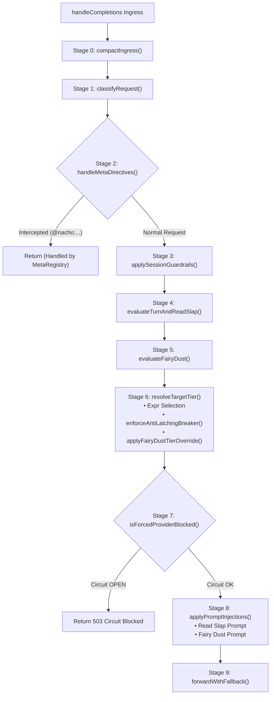

# Architectural Refactoring Plan: `handleCompletions` Pipeline Decomposition

**Target**: [`pkg/server/pipeline.go`](file:///c:/Users/karlk/development/Go/src/github.com/dixieflatline76/nacho-flow/pkg/server/pipeline.go)  
**Branch**: `refactor/pipeline-completions-stages`  
**Classification**: Code Quality, Maintainability & Anti-Regression Architecture  

---

## 1. Executive Summary & Problem Statement

Currently, `handleCompletions` in [`pkg/server/pipeline.go`](file:///c:/Users/karlk/development/Go/src/github.com/dixieflatline76/nacho-flow/pkg/server/pipeline.go#L96-L486) is a **390-line monolithic function** that intermingles at least nine distinct architectural responsibilities:
1. Ingress NTS wire-speed context compaction
2. AST classification and client harness detection
3. Local meta-directive interception (`@nacho:help`, `@nacho:status`, etc.)
4. Session guardrail directives (`raw-on/off`, `shield-off/on`, `kickstart-off/on`)
5. Turn tracking and Read Slap idle-loop detection
6. Proactive Fairy Dust candidate evaluation
7. Expression-based tier selection
8. **The Anti-Latching De-escalation Circuit Breaker** (lines 364–386)
9. Forced-tier circuit breaker gating & prompt injection before forwarding

Because all state mutations operate sequentially on a single block of code with shared variables, past maintenance inadvertently broke critical control loops—most notably the **Anti-Latching De-escalation Breaker**, which was obscured inside the tier selection block without clear pre- and post-conditions.

### Objective
Safely decompose `handleCompletions` into modular, single-responsibility private helper methods on `*Server`. `handleCompletions` will become a readable **~45-line orchestrator**, with each sub-stage fully isolated, documented, and independently testable.

---

## 2. Memory Management & Pointer-vs-Value Guarantees

Refactoring Go methods that operate on request payloads requires rigorous adherence to memory management rules:

| Entity | Type | Semantics | Refactoring Rule |
| :--- | :--- | :--- | :--- |
| **`reqCtx`** | `*contract.RequestContext` | **Heap Pointer** | Passed by pointer. All field updates (`reqCtx.Retries = ...`, `reqCtx.SessionReadSlapped = ...`) mutate the single canonical instance. Zero copying, zero risk of struct slicing. |
| **`body`** | `[]byte` | **Slice Header** `(Data *byte, Len int, Cap int)` | **Crucial Rule**: Modifying a slice header inside a function does NOT update the caller's stack frame. Any helper that transforms or re-allocates `body` (e.g. NTS or prompt injection) **must explicitly return the new `[]byte`**. |
| **`targetTier`** | `contract.Tier` | **Value Type (Struct)** | Passed and returned by value. Pure functional flow: `targetTier = s.enforceAntiLatchingBreaker(...)`. Eliminates unintended side-effects. |
| **`s.sessionTracker`** | `*router.SessionTracker` | **Thread-Safe Mutexed Pointer** | Internal `sync.RWMutex` protects all state operations across concurrent goroutines. Calling from helper methods preserves identical synchronization. |
| **Allocations** | — | **Zero Heap Overhead** | Non-exported package methods are eligible for Go compiler inlining. Passing existing pointers and 24-byte slice headers incurs 0 B/op extra heap allocations. |

---

## 3. Decomposed Pipeline Stages



---

### Detailed Method Specifications

#### Stage 0: `compactIngress`
```go
// compactIngress applies wire-speed NTS context compaction at ingress before classification.
// It returns the potentially transformed body slice along with saved token/byte metrics.
func (s *Server) compactIngress(r *http.Request, body []byte) (compactedBody []byte, tokensSaved, bytesSaved int)
```

#### Stage 1: `classifyRequest`
```go
// classifyRequest parses the request body AST, attaches NTS metrics, and detects the client agent harness.
func (s *Server) classifyRequest(r *http.Request, body []byte, ntsTokensSaved, ntsBytesSaved int, reqLogger *slog.Logger) *contract.RequestContext
```

#### Stage 2: `handleMetaDirectives`
```go
// handleMetaDirectives intercepts local administrative commands (@nacho:help, @nacho:tiers, etc.).
// Returns true if the request was handled and the caller should return immediately.
func (s *Server) handleMetaDirectives(w http.ResponseWriter, r *http.Request, reqCtx *contract.RequestContext, sessionKey string, body []byte) bool
```

#### Stage 3: `applySessionGuardrails`
```go
// applySessionGuardrails processes in-prompt guardrail toggles (e.g., kickstart-off, raw-on)
// and updates reqCtx feature flags and guardrail overrides accordingly.
func (s *Server) applySessionGuardrails(sessionKey string, reqCtx *contract.RequestContext)
```

#### Stage 4: `evaluateTurnAndReadSlap`
```go
// evaluateTurnAndReadSlap tracks session retries, calculates genuine forward progress
// (distinguishing writes/tests from errors), and flags Read Slap when agents idle in loops.
func (s *Server) evaluateTurnAndReadSlap(sessionKey string, reqCtx *contract.RequestContext, cfg *contract.Config, reqLogger *slog.Logger)
```

#### Stage 5: `evaluateFairyDust`
```go
// evaluateFairyDust checks write milestones against configured Fairy Dust entries,
// picking the highest-priority qualifying frontier model review checkpoint.
func (s *Server) evaluateFairyDust(sessionKey string, reqCtx *contract.RequestContext, cfg *contract.Config, reqLogger *slog.Logger)
```

#### Stage 6: `resolveTargetTier` (Container for Tier Selection & Latch Breaker)
```go
// resolveTargetTier selects the execution tier via expression evaluation, applies the
// Anti-Latching De-escalation Breaker, and applies Fairy Dust model overrides.
func (s *Server) resolveTargetTier(sessionKey string, reqCtx *contract.RequestContext, cfg *contract.Config, reqLogger *slog.Logger) contract.Tier
```

#### Stage 7: `isForcedProviderBlocked`
```go
// isForcedProviderBlocked checks the circuit breaker status of a provider when explicit forced directives
// are present (@nacho:tier or @nacho:model), rejecting with an immediate 503 if open.
// Returns true if the request was blocked and handled.
func (s *Server) isForcedProviderBlocked(w http.ResponseWriter, reqCtx *contract.RequestContext, targetTier contract.Tier, body []byte, reqLogger *slog.Logger) bool
```

#### Stage 8: `logRoutingDecision` & `applyPromptInjections`
```go
// logRoutingDecision emits standard structured slog telemetry for the selected tier and context.
func (s *Server) logRoutingDecision(sessionKey string, targetTier contract.Tier, reqCtx *contract.RequestContext, r *http.Request, reqLogger *slog.Logger)

// applyPromptInjections injects Read Slap idle-loop warnings and Fairy Dust quality checkpoint
// prompts into the request payload. Returns the updated body slice.
func (s *Server) applyPromptInjections(sessionKey string, reqCtx *contract.RequestContext, cfg *contract.Config, body []byte, reqLogger *slog.Logger) []byte
```

---

## 3.5 Line-by-Line Audit & Mapping Verification

A strict line-by-line audit of `pkg/server/pipeline.go` (lines 96–486) ensures zero logic drift and complete behavioral fidelity:

| Line Range | Original Responsibility | Target Helper Method | Variable Invariants & Side Effects |
| :--- | :--- | :--- | :--- |
| **96–104** | Body Read & HTTP Stream Close | `handleCompletions` (orchestrator) | Reads `r.Body`; on error writes 400. Closes `r.Body`. |
| **105–121** | Ingress NTS compaction (OpenAI / Anthropic) | `s.compactIngress` | Updates `body`, returns `(body, tokensSaved, bytesSaved)`. Pure slice reassignment. |
| **123–146** | AST Classification & Directive Filtering | `s.classifyRequest` | Returns `*contract.RequestContext`. Initializes NTS metrics, ClientID, and honors `EnableInPromptDirectives`. |
| **143–146** | Session Key & Tracker Initialization | `handleCompletions` | `sessionKey := extractSessionKey(r)`; defensive lazy initialization `s.sessionTracker`. |
| **148–166** | Local Meta Directive Interception | `s.handleMetaDirectives` | If `reqCtx.IsMetaDirective`, dispatches via `s.metaRegistry.Dispatch(...)` and returns `true` (caller early exit). |
| **168–193** | In-Prompt Session Guardrail Directives | `s.applySessionGuardrails` | Extracts directive (`kickstart-off/on`, `raw-on/off`, `fairydust-off/on`, etc.) and mutates tracker. |
| **195–207** | Guardrail Feature Flag Application | `s.applySessionGuardrails` | Sets `reqCtx.NoKickstart`, `NoShield`, `RawModeEnabled`, and masks `reqCtx.Features`. |
| **208–244** | Turn Tracking, Progress & History Override | `s.evaluateTurnAndReadSlap` | Computes prompt hashes, checks `turnProgress`, calls `RecordTurnTask`, applies `HistoryErrors > retries` override, populates `reqCtx.Retries` & `reqCtx.IsRetry`. |
| **246–294** | Read Slap Semantic Stall & Slaps Cap | `s.evaluateTurnAndReadSlap` | Checks `writeOnly` progress, evaluates `RecordKickstartState`, sets `reqCtx.SessionReadSlapped`, enforces `maxSlaps` cap by setting `reqCtx.ForcedTier = "cloud"`. |
| **296–346** | Fairy Dust Checkpoint Selection | `s.evaluateFairyDust` | Checks `s.sessionTracker.GetGuardrails(sessionKey).FairyDustDisabled`. Records write progress, evaluates candidates, selects highest priority `winner`, sets `reqCtx.FairyDusted = true`. |
| **357–363** | Tier Evaluation via Expr Engine | `s.resolveTargetTier` | Invokes `s.GetEvaluator().SelectTier(reqCtx)`. Fallback to `cfg.DefaultTier` on error. |
| **364–386** | **Anti-Latching De-escalation Breaker** | `s.enforceAntiLatchingBreaker` | If `targetTier == DefaultTier`, tracks escalation. If exhausted (turns >= 3), overrides to first non-default tier. Resets counter if not on default. |
| **388–407** | Fairy Dust Tier Override | `s.applyFairyDustTierOverride` | If `reqCtx.FairyDusted`, constructs ephemeral `contract.Tier` with winner's model and provider. |
| **409–427** | Forced Directive Circuit Breaker | `s.isForcedProviderBlocked` | If forced tier/model provider circuit is OPEN, renders circuit alert and returns `true` (caller early exit). |
| **429–450** | Telemetry Slog Logging | `s.logRoutingDecision` | Emits 20 structured fields logging tier routing, session progress, token savings, and client attributes. |
| **452–483** | Prompt Injections (Read Slap & Fairy Dust) | `s.applyPromptInjections` | Prepends Read Slap warning prompt and/or Fairy Dust checkpoint prompt via `injectCorrectionPrompt`. Calls `RecordKickstartFailure`. Returns updated `body []byte`. |
| **485** | Upstream Dispatch with Fallback | `s.forwardWithFallback` | Dispatches request with selected tier, updated body, context, and fallback recovery. |

## 4. Deep-Dive: The Anti-Latching De-escalation Breaker

### Architectural Context
In agentic workflows, workhorse tiers have rules like `retries < 2`. When a model hits syntax errors, `retries` increments to 2. This locks out all workhorses and causes expressions to fall back to `DefaultTier` (an expensive frontier model like Claude Opus or Sonnet).

If errors persist, the session remains locked on `DefaultTier` forever (15+ turns, doubling session cost).

### Pre-conditions & Post-conditions

```go
// enforceAntiLatchingBreaker prevents sessions from permanently latching onto the expensive
// default tier when accumulated retries lock out economical workhorse tiers.
//
// Pre-conditions:
//   - targetTier has been evaluated via expr engine or default fallback.
//   - reqCtx.Retries and reqCtx.HistoryErrors have been updated.
//   - cfg contains DefaultTier and configured Tiers slice.
//
// Post-conditions:
//   - If targetTier == DefaultTier and escalation turns >= MaxEscalationTurns (default: 3),
//     targetTier is forcibly overridden to an economical non-default cloud tier to allow
//     forward progress to reset retries to 0.
//   - If targetTier != DefaultTier, the escalation budget counter is reset to 0.
func (s *Server) enforceAntiLatchingBreaker(
	sessionKey string,
	targetTier contract.Tier,
	cfg *contract.Config,
	reqLogger *slog.Logger,
) contract.Tier {
	defaultTierName := cfg.DefaultTier.Name
	if targetTier.Name != defaultTierName {
		s.sessionTracker.ResetEscalation(sessionKey)
		return targetTier
	}

	budgetExhausted := s.sessionTracker.RecordEscalation(sessionKey)
	if budgetExhausted {
		// Force de-escalation: pick the first available non-default cloud tier
		for _, tier := range cfg.Tiers {
			if tier.Name != defaultTierName {
				reqLogger.Warn("Escalation budget exhausted, forcibly de-escalating",
					slog.String("fallback_tier", tier.Name),
					slog.String("fallback_model", tier.Model),
					slog.String("session_key", sessionKey),
				)
				return tier
			}
		}
	}
	return targetTier
}
```

---

## 5. The Resulting `handleCompletions` Orchestrator

When refactored, the entire `handleCompletions` function fits on a single screen without scrolling:

```go
func (s *Server) handleCompletions(w http.ResponseWriter, r *http.Request, startTime time.Time, reqLogger *slog.Logger) {
	body, err := io.ReadAll(r.Body)
	if err != nil {
		reqLogger.Error("Failed to read request body", slog.Any("error", err))
		http.Error(w, "Failed to read request body", http.StatusBadRequest)
		return
	}
	_ = r.Body.Close()

	// 0. Wire-speed ingress context compaction (NTS)
	body, ntsTokensSaved, ntsBytesSaved := s.compactIngress(r, body)

	// 1. Classify request metadata & client detection
	reqCtx := s.classifyRequest(r, body, ntsTokensSaved, ntsBytesSaved, reqLogger)
	sessionKey := extractSessionKey(r)

	// 2. Intercept local meta directives (@nacho:help, @nacho:tiers, etc.)
	if s.handleMetaDirectives(w, r, reqCtx, sessionKey, body) {
		return
	}

	// 3. Apply session guardrail directives (raw-on, shield-off, kickstart-off)
	s.applySessionGuardrails(sessionKey, reqCtx)

	cfg := s.GetConfig()

	// 4. Track session turns & detect Read Slap semantic stalls
	s.evaluateTurnAndReadSlap(sessionKey, reqCtx, cfg, reqLogger)

	// 5. Evaluate proactive Fairy Dust checkpoints
	s.evaluateFairyDust(sessionKey, reqCtx, cfg, reqLogger)

	// 6. Select execution tier with Anti-Latching Breaker & Fairy Dust overrides
	targetTier := s.resolveTargetTier(sessionKey, reqCtx, cfg, reqLogger)

	// 7. Check circuit breaker for forced provider directives
	if s.isForcedProviderBlocked(w, reqCtx, targetTier, body, reqLogger) {
		return
	}

	s.logRoutingDecision(sessionKey, targetTier, reqCtx, r, reqLogger)

	// 8. Apply prompt corrections (Read Slap & Fairy Dust injection)
	body = s.applyPromptInjections(sessionKey, reqCtx, cfg, body, reqLogger)

	// 9. Upstream proxy dispatch with automated tier fallback
	s.forwardWithFallback(w, r, reqCtx, targetTier, body, startTime, reqLogger)
}
```

---

## 6. Step-by-Step TDD Execution Plan

### Step 1: Branch Creation & Environment Verification
- [x] Switched to `main`, pulled latest commit (`714d6ea` merged PR #75).
- [x] Created refactor branch: `refactor/pipeline-completions-stages`.
- [x] Measured baseline coverage on `pipeline.go` (89.5% statements). Identified key uncovered branches:
  - Anti-latching boundary conditions (turns 1-3 vs 4 vs 5).
  - In-history error overrides (`HistoryErrors > retries`).
  - In-prompt guardrails (`raw-on/off`, `fairydust-on/off`, `shield-on/off`).
  - Read Slap custom prompt override & max slaps cap (`reqCtx.ForcedTier = "cloud"`).
  - Fairy Dust multi-entry priority selection & custom checkpoint prompts.
  - Forced provider circuit breaker 503 rejection.

### Step 2: TDD Phase 1 — Author Pre-Refactoring Pipeline Test Suite (`pkg/server/pipeline_test.go`)
- Create `pkg/server/pipeline_test.go` targeting existing `handleCompletions` to establish an ironclad test harness:
  1. `TestPipeline_AntiLatchingBreaker_UnderBudgetAndDeescalate`: Turns 1–3 on `DefaultTier` remain on default tier; Turn 4 de-escalates to first non-default cloud tier; Turn 5 on workhorse resets escalation budget.
  2. `TestPipeline_HistoryErrorsOverride`: Ensures in-history errors override session tracker `retries` and mark `isRetry = true`.
  3. `TestPipeline_EmbeddedGuardrailToggles`: Verifies all directives (`kickstart-off/on`, `raw-on/off`, `shield-off/on`, `fairydust-off/on`) and feature flag masking (`RawModeEnabled`, `ShieldDisabled`).
  4. `TestPipeline_ReadSlap_PromptOverrideAndMaxSlapsCap`: Tests Read Slap idle-loop warning injection, custom prompt override, and force-escalation to cloud tier when `kickstartCount >= maxSlaps`.
  5. `TestPipeline_FairyDust_PriorityAndCustomPrompt`: Tests that higher-priority Fairy Dust candidate wins, and its custom prompt is injected.
  6. `TestPipeline_ForcedProviderCircuitBlocked`: Verifies that an open circuit on a forced provider returns 503 immediately without fallback.
- **Run `go test -v ./pkg/server -run TestPipeline_` on existing code to prove 100% green before any refactoring.**

### Step 3: Refactoring Phase — Extract 9 Modular Helpers in `pkg/server/pipeline.go`
- Extract helper methods:
  - Stage 0: `compactIngress`
  - Stage 1: `classifyRequest`
  - Stage 2: `handleMetaDirectives`
  - Stage 3: `applySessionGuardrails`
  - Stage 4: `evaluateTurnAndReadSlap`
  - Stage 5: `evaluateFairyDust`
  - Stage 6: `resolveTargetTier`, `enforceAntiLatchingBreaker`, `applyFairyDustTierOverride`
  - Stage 7: `isForcedProviderBlocked`
  - Stage 8: `logRoutingDecision`, `applyPromptInjections`
- Replace monolithic `handleCompletions` with the clean 45-line orchestrator.
- Re-run `go test -v ./pkg/server -run TestPipeline_` to verify immediate equivalence.

### Step 4: TDD Phase 2 — Dedicated Anti-Latching Breaker Unit Tests (`pkg/server/anti_latching_test.go`)
- Author direct unit tests for `enforceAntiLatchingBreaker` in isolation, asserting pre/post conditions and escalation counter transitions.

### Step 5: Verification & Quality Assurance Gates
1. **`go test -v ./pkg/server/...`**: Verify all proxy, stream, truncation, thought slap, and pipeline tests pass.
2. **`make check`**: Full verification gate (`fmt`, `vet`, `gosec`, `test-race`, `test-extension`).
3. **`make bench-sync`**: Verify nanosecond performance, proving zero allocation regressions.

---

## 7. Risk Analysis & Mitigation Matrix

| Risk | Likelihood | Impact | Mitigation |
| :--- | :---: | :---: | :--- |
| **Slice Header Desync** (`body` not updating) | Low | High | Helper signatures return `[]byte` explicitly; caller assigns `body = ...`. |
| **Fairy Dust Overrides Skipped** | Low | High | `resolveTargetTier` explicitly executes `applyFairyDustTierOverride` as final stage before returning. |
| **Escalation Budget State Leak** | Low | Medium | Uses existing `s.sessionTracker.RecordEscalation` and `ResetEscalation` mutexed methods. |
| **Hot-Path Allocations** | Low | Low | Method calls within the same package with pointer arguments incur 0 heap allocations. Verified with benchmark tests. |
