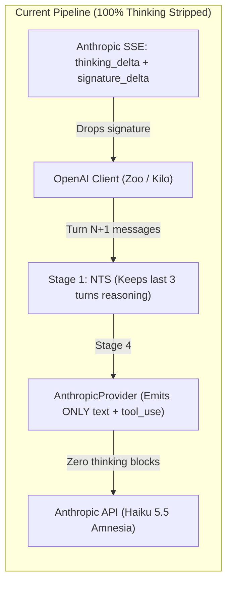
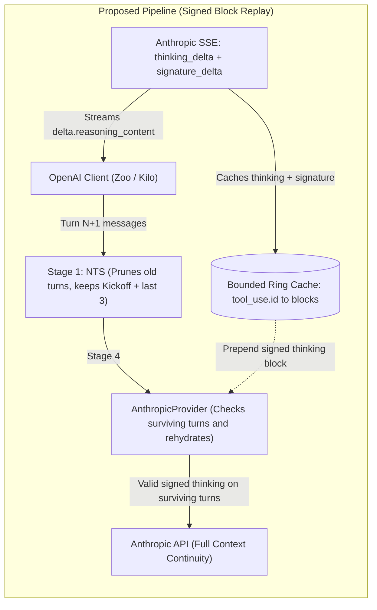
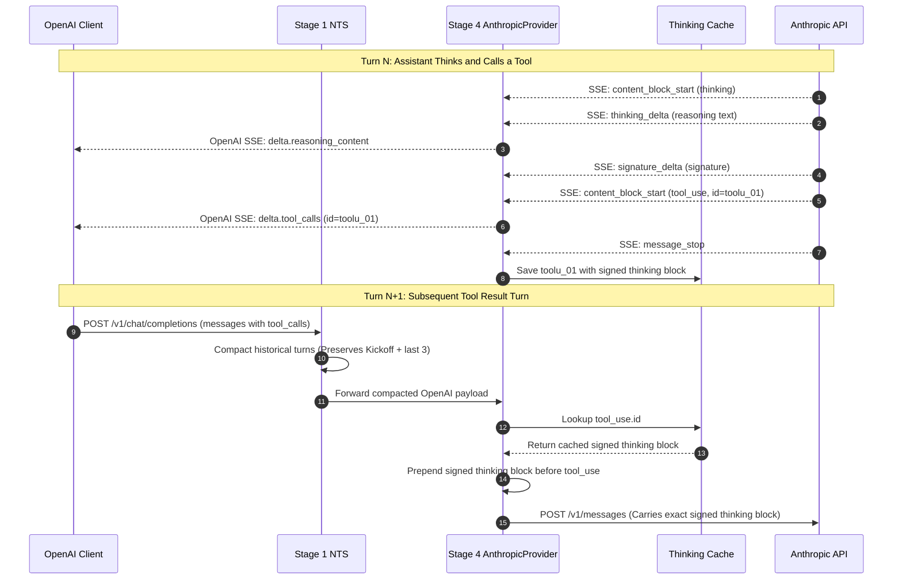
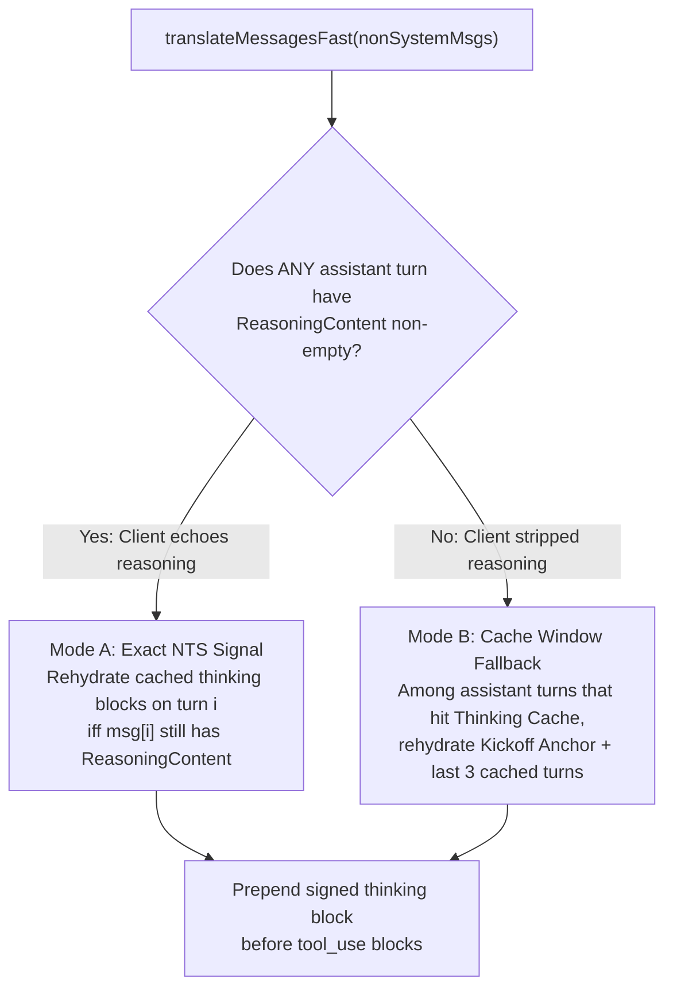

# Implementation Plan: Bridging NTS & `AnthropicProvider` for Signed Thinking Block Preservation

> [!IMPORTANT]
> **Design Philosophy (Zero Over-Engineering)**
> - **No new interfaces**, **no changes to `pkg/nts`**, and **no model-to-model compatibility matrices**.
> - Anthropic's API already silently drops incompatible cross-model thinking blocks server-side (e.g., Sonnet 5.5 blocks sent to Haiku 5.5) without returning an error.
> - NTS (Stage 1) already marks surviving vs. pruned turns directly in the OpenAI payload by preserving or deleting `reasoning_content`.
> - The entire mechanism lives privately inside [`pkg/provider/anthropic.go`](file:///c:/Users/karlk/development/Go/src/github.com/dixieflatline76/nacho-flow/pkg/provider/anthropic.go) and [`pkg/provider/anthropic_stream.go`](file:///c:/Users/karlk/development/Go/src/github.com/dixieflatline76/nacho-flow/pkg/provider/anthropic_stream.go).

---

## 1. Problem Overview & Before/After Architecture

When OpenAI-compatible clients (Zoo Code, Kilo Code, Cline) communicate with Nacho Flow via `/v1/chat/completions`, the OpenAI wire schema has no field for Anthropic's cryptographic `signature` (or `redacted_thinking.data`).

Currently:
1. **Egress (`AnthropicStreamAdapter`):** Streams `thinking_delta` as OpenAI `delta.reasoning_content`, but discards `signature_delta` and `redacted_thinking`.
2. **Ingress Stage 1 (`nts.Transformer`):** Runs Semantic Reasoning Compaction (SRC), deleting `reasoning_content` on older turns while keeping `reasoning_content` on the **Kickoff Anchor**, the **3 most recent turns** (`keep_recent_reasoning_turns: 3`), and **active error-retry turns**.
3. **Outbound Stage 4 (`AnthropicProvider.BuildUpstreamRequest`):** Unmarshals into `fastOpenAIMsg` (which lacks `ReasoningContent`) and emits only `text` and `tool_use` blocks — wiping out 100% of historical `thinking` blocks.





```text
┌─────────────────────────────────────────────────────────────────────────────┐
│ ❌ BEFORE: 100% Historical Thinking Stripped                                │
├─────────────────────────────────────────────────────────────────────────────┤
│                                                                             │
│   Anthropic SSE                                                             │
│   [thinking + signature] ──> Nacho Flow ──> OpenAI Client (Zoo / Kilo)      │
│                              (Drops signature)                              │
│                                                     │                       │
│                                                     ▼ (Turn N+1 messages)   │
│   Anthropic API <─────────── Nacho Flow <───────────┘                       │
│   (Haiku 5.5 Amnesia)        (Stage 1 NTS keeps reasoning_content, but      │
│   Zero thinking blocks        Stage 4 AnthropicProvider emits ONLY text     │
│   Model re-deliberates        and tool_use — historical thinking is wiped)  │
│   and hits token limit!                                                     │
│                                                                             │
└─────────────────────────────────────────────────────────────────────────────┘

┌─────────────────────────────────────────────────────────────────────────────┐
│ ✅ AFTER: NTS-Guided Signed Block Replay                                    │
├─────────────────────────────────────────────────────────────────────────────┤
│                                                                             │
│   Anthropic SSE             ┌─────────────────────────┐                     │
│   [thinking + signature] ──>│ Cache: tool_use.id ───> │                     │
│         │                   │ {thinking, signature}   │                     │
│         ▼                   └────────────┬────────────┘                     │
│   OpenAI Client (Zoo / Kilo)             │ (Prepend signed thinking block)  │
│         │ (Turn N+1 messages)            ▼                                  │
│         ▼                                                                   │
│   Stage 1 NTS ────────────> Stage 4 AnthropicProvider ──> Anthropic API     │
│   (Prunes old turns,        (Rehydrates surviving turns   (Full Context     │
│    keeps Kickoff + last 3)   from Bounded Ring Cache)      Continuity!)     │
│                                                                             │
└─────────────────────────────────────────────────────────────────────────────┘
```

---

## 2. End-to-End Sequence Diagram Across Multi-Turn Tool Loops



```text
Turn N (Execution):
  Anthropic API ──> SSE {thinking + signature} ──> AnthropicStreamAdapter
                          │                               │
                          ▼ (Store)                       ▼ (Emit OpenAI SSE)
               Cache[toolu_01] = block           Client receives delta.reasoning_content

Turn N+1 (Follow-up):
  Client sends messages[] with tool_calls: [{id: "toolu_01"}]
       │
       ▼
  Stage 1 (NTS): Decides retention (Kickoff + recent 3 turns kept)
       │
       ▼
  Stage 4 (AnthropicProvider):
       ├─ If turn kept: Cache.Get("toolu_01") ──> prepends {thinking, signature}
       └─ If turn pruned: omits thinking block (thinking block clearing)
       │
       ▼
  Anthropic API receives exact cryptographic signature ──> Claude retains full context!
```

---

## 3. Handling Both Client Behaviors (Echoing vs. Stripping `reasoning_content`)

Different OpenAI-compatible clients handle `reasoning_content` differently when sending `messages[]` on subsequent turns:
- **Clients that echo `reasoning_content` (e.g., Zoo Code):** Send `reasoning_content` back on assistant turns in `messages[]`. Stage 1 NTS deletes `reasoning_content` on pruned turns and keeps it on surviving turns (`Kickoff` + `keep_recent_reasoning_turns: 3` + error turns).
- **Clients that strip `reasoning_content` (strict OpenAI SDK / DeepSeek R1 spec clients):** Never send `reasoning_content` back in `messages[]` on any historical assistant turn.



```text
                       translateMessagesFast(nonSystemMsgs)
                                        │
                                        ▼
                  ┌───────────────────────────────────────────┐
                  │ Does ANY assistant turn in conversation   │
                  │ have reasoning_content / reasoning text?  │
                  └─────────────────────┬─────────────────────┘
                                        │
                       ┌────────────────┴────────────────┐
                  YES  │                                 │  NO
        (Client echoes reasoning)              (Client strips reasoning)
                       │                                 │
                       ▼                                 ▼
       ┌───────────────────────────────┐ ┌───────────────────────────────┐
       │   MODE A: Exact NTS Signal    │ │ MODE B: Cache Window Fallback │
       │                               │ │                               │
       │ Rehydrate cached thinking     │ │ Among turns in Thinking Cache,│
       │ block on turn i ONLY IF       │ │ rehydrate Kickoff Anchor +    │
       │ msg[i] still has reasoning!   │ │ the 3 most recent turns!      │
       └───────────────┬───────────────┘ └───────────────┬───────────────┘
                       │                                 │
                       └────────────────┬────────────────┘
                                        │
                                        ▼
                       ┌─────────────────────────────────┐
                       │ Prepend signed thinking block   │
                       │ before tool_use in Content[]    │
                       └─────────────────────────────────┘
```

> [!TIP]
> **Why This Dual-Mode Check Is Important**
> - In **Mode A**, `AnthropicProvider` honors NTS's exact per-turn decisions (including Kickoff high-watermark, agent profile retention overrides, and tool-error streak freezes).
> - In **Mode B**, if a client never sends `reasoning_content` back in `messages[]`, `AnthropicProvider` still preserves the Kickoff thinking block and the 3 most recent thinking turns instead of dropping all of them.

---

## 4. Detailed Code Changes

All changes are confined to two files in `pkg/provider` (plus unit tests):

### A. Bounded Thinking Block Cache (`pkg/provider/anthropic.go`)

Add a small, thread-safe, bounded ring/FIFO cache (`thinkingBlockCache`, capacity `256` tool turns) on [`AnthropicProvider`](file:///c:/Users/karlk/development/Go/src/github.com/dixieflatline76/nacho-flow/pkg/provider/anthropic.go#L48-L58):

```go
const maxCachedThinkingTurns = 256

type cachedThinkingBlock struct {
	Type      string // "thinking" or "redacted_thinking"
	Model     string // e.g. "claude-haiku-5-5" (cross-model safety check)
	Thinking  string
	Signature string
	Data      string // for "redacted_thinking"
}

type thinkingBlockCache struct {
	mu      sync.RWMutex
	entries map[string][]cachedThinkingBlock // keyed by tool_use.id
	order   [maxCachedThinkingTurns]string   // fixed-size ring buffer for O(1) eviction
	head    int
	count   int
}
```

- **Zero unbounded memory growth:** Fixed 256-slot ring buffer evicts the oldest `tool_use.id` in $O(1)$ time when full.
- **Keyed by `tool_use.id` (`toolu_01...`):** Globally unique per assistant tool turn and guaranteed to be echoed back in `messages[i].tool_calls[0].id` by every OpenAI client.

### B. Stream & Unary Capture (`pkg/provider/anthropic_stream.go` & `pkg/provider/anthropic.go`)

1. **In [`AnthropicStreamAdapter`](file:///c:/Users/karlk/development/Go/src/github.com/dixieflatline76/nacho-flow/pkg/provider/anthropic_stream.go#L19-L43):**
   - Pass `cache *thinkingBlockCache` into `NewAnthropicStreamAdapter` from [`AnthropicProvider.WrapResponseStream`](file:///c:/Users/karlk/development/Go/src/github.com/dixieflatline76/nacho-flow/pkg/provider/anthropic.go#L132-L134).
   - Update [`fastSSEContentBlock`](file:///c:/Users/karlk/development/Go/src/github.com/dixieflatline76/nacho-flow/pkg/provider/anthropic_stream.go#L324-L329) and [`fastSSEDelta`](file:///c:/Users/karlk/development/Go/src/github.com/dixieflatline76/nacho-flow/pkg/provider/anthropic_stream.go#L331-L337) to include:
     - `ContentBlock.Thinking string`, `ContentBlock.Signature string`, `ContentBlock.Data string`
     - `Delta.Signature string` (for `signature_delta` events)
   - On the fast path in [`dispatchData`](file:///c:/Users/karlk/development/Go/src/github.com/dixieflatline76/nacho-flow/pkg/provider/anthropic_stream.go#L136-L141): when `"thinking":` is extracted, also accumulate the unescaped thinking string into `a.currentThinkingBuf` so the exact text signed by Anthropic is preserved.
   - On `signature_delta`, append `sse.Delta.Signature` to `a.currentSignatureBuf`.
   - On `content_block_stop`, finalize the completed `thinking` (with non-empty `signature`) or `redacted_thinking` block into `a.turnThinkingBlocks`.
   - On `message_stop` / EOF / `Close()`, associate all `tool_use.id`s from that turn with `a.turnThinkingBlocks` in `a.cache`.
2. **In [`TranslateResponseBody`](file:///c:/Users/karlk/development/Go/src/github.com/dixieflatline76/nacho-flow/pkg/provider/anthropic.go#L374-L451) (Non-Streaming Path):**
   - Add `Signature string` and `Data string` to [`fastAnthropicRespBlock`](file:///c:/Users/karlk/development/Go/src/github.com/dixieflatline76/nacho-flow/pkg/provider/anthropic.go#L577-L584).
   - Capture any `thinking` / `redacted_thinking` blocks alongside all `tool_use.id`s and store them in `p.thinkingCache`.

### C. Outbound Rehydration (`pkg/provider/anthropic.go`)

1. **In [`fastOpenAIMsg`](file:///c:/Users/karlk/development/Go/src/github.com/dixieflatline76/nacho-flow/pkg/provider/anthropic.go#L479-L485):**
   - Add `ReasoningContent string` (`json:"reasoning_content,omitempty"`) and `Reasoning string` (`json:"reasoning,omitempty"`).
2. **In [`fastAnthropicContentBlock`](file:///c:/Users/karlk/development/Go/src/github.com/dixieflatline76/nacho-flow/pkg/provider/anthropic.go#L530-L540):**
   - Add:
     ```go
     Thinking  *string `json:"thinking,omitempty"`
     Signature string  `json:"signature,omitempty"`
     Data      string  `json:"data,omitempty"`
     ```
   - Using `*string` for `Thinking` guarantees that when `Type == "thinking"`, `"thinking": ""` is still serialized even if the thinking text is empty (e.g. signature-only blocks on Haiku 5.5), whereas on `text` and `tool_use` blocks `Thinking` is `nil` and omitted.
3. **In [`translateMessagesFast`](file:///c:/Users/karlk/development/Go/src/github.com/dixieflatline76/nacho-flow/pkg/provider/anthropic.go#L685-L728) & [`convertMessageContentFast`](file:///c:/Users/karlk/development/Go/src/github.com/dixieflatline76/nacho-flow/pkg/provider/anthropic.go#L730-L774):**
   - Determine which assistant tool-call turns should rehydrate their cached thinking blocks (using Mode A when `reasoning_content` is present in the conversation, or Mode B fallback when the client strips `reasoning_content`).
   - Only rehydrate thinking blocks when the outbound request actually enables thinking (`thinking != nil && thinking.Type != "disabled"`).
   - Guard against cross-model mismatches: only rehydrate if `curation.DefaultManager().IsSameModel(block.Model, targetModel)`.
   - Prepend the cached `thinking` / `redacted_thinking` block(s) **first** in the assistant message's `Content` slice (before any `text` and `tool_use` blocks, as required by Anthropic's Messages API spec).

---

## 5. Verification & Test Plan

1. **Unit Tests in [`pkg/provider/anthropic_test.go`](file:///c:/Users/karlk/development/Go/src/github.com/dixieflatline76/nacho-flow/pkg/provider/anthropic_test.go):**
   - **Stream Capture + Multi-Turn Replay (Mode A — NTS Signal):**
     - Stream an Anthropic SSE response containing `thinking_delta` + `signature_delta` + `tool_use` (`toolu_01`).
     - Build a follow-up request across 5 assistant turns where NTS kept `reasoning_content` on Turn 1 (Kickoff) and Turns 3–5, and deleted `reasoning_content` on Turn 2.
     - Verify the outbound `/v1/messages` request contains `{type: "thinking", thinking, signature}` on Turn 1 and Turns 3–5, and **omits** the thinking block on Turn 2.
   - **Client Strips `reasoning_content` Fallback (Mode B):**
     - Verify that if a client sends 5 assistant tool-call turns with empty `reasoning_content` on all of them, `AnthropicProvider` still rehydrates Turn 1 (Kickoff) + the last 3 turns from cache and clears Turn 2.
   - **Empty Thinking + Signature-Only Block (`thinking: ""`):**
     - Verify a Haiku 5.5 signature-only thinking block (`thinking: ""`, `signature: "sig_abc"`) serializes `"thinking": ""` (not omitted by `omitempty`) in the outbound JSON.
   - **Cross-Model Escalation Guard:**
     - Verify that if a thinking block from Sonnet 5.5 is in cache, but the outbound request targets Haiku 5.5, the block is safely omitted.
   - **Thinking Disabled Guard:**
     - Verify that when `reasoning_effort: "none"` (`thinking: {"type": "disabled"}`), no cached thinking blocks are injected into the outbound request.
   - **Ring Buffer Eviction:**
     - Verify inserting > 256 tool turns cleanly overwrites the oldest slot without growing memory.
2. **Build & Local VSIX Deployment:**
   - Run `go test ./pkg/provider/... ./pkg/nts/... ./pkg/server/...`
   - Deploy `big-refactor-4` and update the running `nacho-flow.exe` binary.
